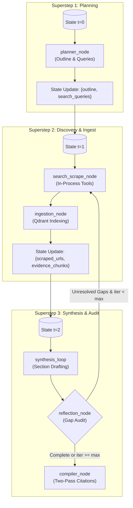
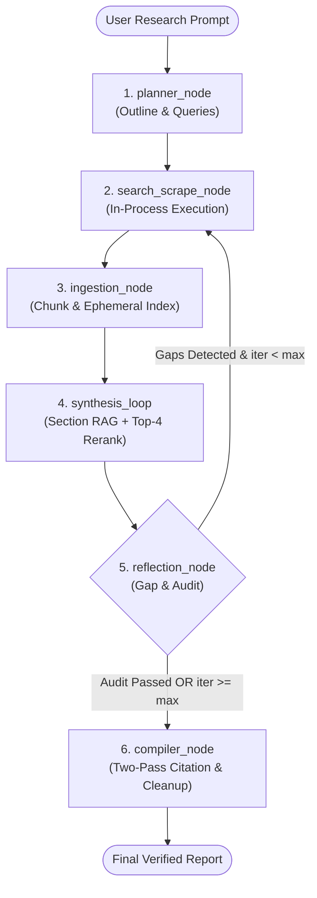
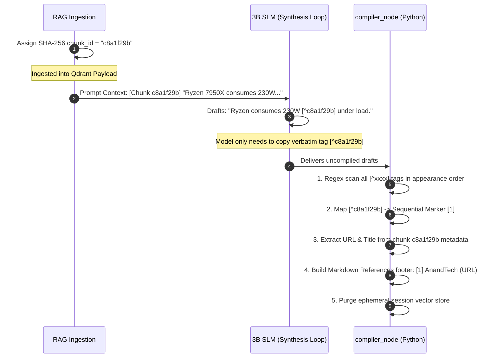

# Technical Explainer: LangGraph Cyclic State Machine, Self-Correction & Two-Pass Citations

This document breaks down the fundamental concepts, graph execution algorithms, state management patterns, and design rationale behind **Section 3.4 (Agent Orchestration: LangGraph Cyclic State Machine)** of DeepSearch-Local.

---

> [!NOTE]
> **Implementation Status: Fully Implemented - Phase 4 (PRD Section 3.4)**  
> The LangGraph cyclic state machine control plane, Pydantic state schema with channel reducers, 6 discrete graph nodes, prompt templates, unified LLM client interface, and Two-Pass Citation Resolution are implemented and verified via automated test suites.

---

## 1. The Core Architectural Challenge: Cyclic Self-Correction on Bounded Contexts

Linear Retrieval-Augmented Generation (RAG) pipelines follow a simple Directed Acyclic Graph (DAG):
`Prompt -> Query -> Search -> Retrieve -> Generate Answer`.

In open-ended deep research, linear pipelines suffer from two catastrophic failure modes:
1. **Premature Convergence & Evidence Blind Spots:** A user prompt like *"Compare AMD Ryzen 7000 and Intel 13th Gen power consumption under AVX-512"* requires multi-perspective investigation (architectural differences, idle draw, peak AVX-512 load, socket limits). A single search query will only surface superficial marketing overviews, missing technical data sheets.
2. **Context Window Blowout on 3B SLMs:** Large commercial agents (e.g. OpenAI Deep Research) dump dozens of scraped web pages directly into massive 128k–1M context windows. DeepSearch-Local operates a **3B SLM bounded to a 4,096-token context window**. Dumping raw scraped articles into the prompt causes instant attention degradation ("lost in the middle") and context truncation.

To solve this, DeepSearch-Local utilizes a **cyclic state graph** that decomposes the topic, synthesizes section-by-section using localized top-4 hybrid chunks, audits drafts for factual gaps, and re-triggers targeted search loops before final report compilation.

---

## 2. LangGraph Architecture & The Pregel Execution Model

DeepSearch-Local builds its control plane on **LangGraph (v0.2+)**, a library for building stateful, multi-actor applications with LLMs.

### The Pregel Algorithm
LangGraph executes agent state graphs using the **Pregel Bulk Synchronous Parallel (BSP)** computational model:
- Computation proceeds in discrete **supersteps**.
- In each superstep, active nodes execute concurrently or sequentially according to graph topology.
- Nodes take the current immutable **State snapshot** as input and return **State updates**.
- State channels update atomically between supersteps using designated **channel reducers**.
- Graph routing is controlled via deterministic or **conditional edges** evaluating state conditions.



---

## 3. Pydantic State Schema & Channel Reducers

In LangGraph, state is defined as a strongly-typed Pydantic model (`ResearchState` in `agent/state.py`) where fields specify how updates from different nodes are merged.

### The `ResearchState` Schema (`agent/state.py`)
```python
import operator
import uuid
from typing import Annotated, Any, Dict, List, Optional, Set
from pydantic import BaseModel, Field

def merge_url_sets(existing: Set[str], update: Set[str]) -> Set[str]:
    """Channel reducer for merging scraped URL sets without inspect.signature issues."""
    return existing.union(update)

class ResearchState(BaseModel):
    """Pydantic state machine schema for multi-step cyclic deep research."""

    session_id: str = Field(default_factory=lambda: uuid.uuid4().hex[:8])
    research_topic: str
    outline: List[str] = Field(default_factory=list)
    search_queries: Annotated[List[str], operator.add] = Field(default_factory=list)
    scraped_urls: Annotated[Set[str], merge_url_sets] = Field(default_factory=set)
    evidence_chunks: Annotated[List[Dict[str, Any]], operator.add] = Field(default_factory=list)
    raw_documents: List[Dict[str, Any]] = Field(default_factory=list)
    sections: Dict[str, str] = Field(default_factory=dict)
    sections_to_revise: List[str] = Field(default_factory=list)
    unresolved_gaps: List[str] = Field(default_factory=list)
    iteration_count: int = 0
    max_iterations: int = 2
    final_report: Optional[str] = None
    citation_map: Dict[str, Dict[str, str]] = Field(default_factory=dict)
    retain_collection: bool = False
```

### What is a Channel Reducer?
By default, if a node returns `{"search_queries": ["query3"]}`, LangGraph would overwrite the entire list, erasing previous queries.
- `Annotated[List[str], operator.add]`: Defines an append reducer. When a node outputs new queries, LangGraph computes `state["search_queries"] + new_queries`, appending to the persistent audit log.
- `Annotated[Set[str], merge_url_sets]`: Merges newly visited URLs into the existing set, guaranteeing $O(1)$ duplicate lookup and avoiding redundant network downloads.
- `Annotated[List[Dict[str, Any]], operator.add]`: Accumulates all evidence chunks retrieved across initial and revision loops into a permanent citational registry.

---

## 4. Six-Node Graph Topology & Control Flow

The agentic state machine is composed of 6 discrete nodes interconnected by conditional routing edges:



### Detailed Node Specifications

#### 1. `planner_node` (`agent/nodes/planner.py`)
- **Responsibility:** Decomposes the initial user topic into a structured, chronological outline (4–6 sections) and generates an initial pool of 3–5 orthogonal search queries.
- **Model Role:** Uses the 3B SLM fine-tuned on query decomposition via `AgentLLM`.
- **Output:** Returns updates for `outline` and `search_queries`. Includes deterministic fallback planning if LLM JSON parsing fails.

#### 2. `search_scrape_node` (`agent/nodes/search.py`)
- **Responsibility:** Executes search queries via in-process `web_search()`. Filters results against `state.scraped_urls` to avoid redundant fetching. Fetches novel candidate pages via `fetch_page_markdown()` with strict SSRF protection.
- **Execution:** Pure Python in-process tool dispatch ($0\text{ ms}$ IPC).
- **Output:** Returns newly scraped URLs (`scraped_urls`) and raw document payloads (`raw_documents`).

#### 3. `ingestion_node` (`agent/nodes/ingest.py`)
- **Responsibility:** Ingests cleaned Markdown text, splits text into 512-token chunks with 64-token overlap using `RecursiveMarkdownChunker`, generates dense embeddings (`bge-small`) and sparse BM25 indices on CPU, and indexes chunks into the ephemeral Qdrant collection (`session_{uuid}`).
- **Hardware Isolation:** Pinned strictly to CPU threads; zero CUDA VRAM touched.
- **Output:** Populates Qdrant and updates `evidence_chunks` with chunk metadata while resetting `raw_documents: []`.

#### 4. `synthesis_loop` (`agent/nodes/synth.py`)
- **Responsibility:** Iterates section-by-section through `outline`. For each section:
  1. Queries Qdrant for top-15 candidates using server-side Prefetch + RRF ($k=60$).
  2. Reranks candidates down to top-4 using `bge-reranker-base` on CPU.
  3. Prompts the 3B SLM with **only the section outline and the top-4 chunks** (~2,000 tokens total), ensuring it fits comfortably in the 4,096 context window.
  4. The model drafts the section using temporary citation tags: `[^chunk_hash]`.
  5. In revision loops (`iteration_count > 0`), selectively revises only `sections_to_revise` using `SYNTH_REVISION_SYSTEM_PROMPT`.
- **Output:** Updates `sections[section_title] = draft_text` and emits candidate chunks to `evidence_chunks`.

#### 5. `reflection_node` (`agent/nodes/reflect.py`)
- **Responsibility:** Audits drafted sections against the original research outline and retrieved evidence.
  - Checks whether required sub-questions lack factual support.
  - Detects unresolved claims or conflicting numbers.
- **Conditional Routing:**
  - If gaps exist and `iteration_count < max_iterations`:
    - Populates `sections_to_revise` and formulates targeted follow-up queries.
    - Increments `iteration_count`.
    - Routes back to `search_scrape_node`.
  - If all sections have grounded evidence OR `iteration_count >= max_iterations`:
    - Clears `sections_to_revise` and routes to `compiler_node`.

#### 6. `compiler_node` (`agent/nodes/compile.py`)
- **Responsibility:** Consolidates all drafted sections into a single publication-ready Markdown report.
  - Executes **Two-Pass Citation Normalization** (see Section 5).
  - Strips unverified/hallucinated orphan citation tags and records telemetry.
  - Generates the unified sequential Bibliography (`## References`).
  - Populates `final_report` and `citation_map`.
  - Drops the ephemeral Qdrant collection unless `retain_collection` is set.
- **Output:** Returns `final_report` and `citation_map`.

---

## 5. The Two-Pass Citation Resolution Architecture

A critical vulnerability in small language models is **citation hallucination**. When asked to output sequential numbers (`[1]`, `[2]`, `[3]`) while drafting text across multiple sections, SLMs frequently lose count, duplicate numbers, or cite non-existent sources.

DeepSearch-Local introduces a **Two-Pass Citation Resolution Architecture**:

```
Pass 1: Probabilistic Section Drafting (SLM)
Passage: "AMD Ryzen 7950X consumes 230W under full AVX-512 workload [^c8a1f29b]."
         (Uses deterministic 8-to-12 character chunk hash directly from prompt context)

Pass 2: Deterministic Citation Normalization (Python Compiler Node)
Text:    "AMD Ryzen 7950X consumes 230W under full AVX-512 workload [1]."
Sources: [1] AnandTech, "AMD Ryzen 7000 Power & Efficiency Review", https://...
```



### Why Two-Pass Resolution Eliminates Hallucination:
- **Zero Arithmetic Required from SLM:** The 3B model is never asked to maintain a global citation counter across independent section generation calls.
- **Verifiable Grounding:** If the model outputs a tag `[^d4e2]` that does not exist in that section's retrieved chunks, the compiler detects the hallucination instantly and strips it from the final text.
- **Deduplication:** If Section 1 and Section 4 both cite chunk `c8a1f29b`, the compiler automatically assigns the exact same sequential index `[1]` to both occurrences.

---

## 6. Context Window Budgeting: How 3B Fits into 4,096 Tokens

A 3B model's KV-cache scales linearly with context length:
- At 4,096 tokens with FP16 KV-cache: $\approx 1,000\text{ MiB}$ VRAM.
- Attempting 16k or 32k tokens on an RTX 3050 would exhaust all 6 GB VRAM and crash Ollama.

DeepSearch-Local solves this by enforcing **strict context partitioning**:

```
+-----------------------------------------------------------------------+
| TOTAL 3B SLM CONTEXT BUDGET: 4,096 TOKENS                             |
+-----------------------------------------------------------------------+
| [System Prompt & Instructions]                           ~ 350 tokens |
| [Section Title & Parent Outline Breadcrumbs]             ~ 150 tokens |
| [Top-4 Hybrid Evidence Chunks (4 x 350 tokens)]        ~ 1,400 tokens |
| [Section Generation Budget (Completion Buffer)]        ~ 1,500 tokens |
| [Safety Margin / Special Delimiters]                     ~ 696 tokens |
+-----------------------------------------------------------------------+
```

By constraining the prompt in `synthesis_loop` to only the relevant section outline and the Top-4 cross-encoder reranked chunks, each generation pass executes in $< 12$ seconds on local GPU with zero context overflow.

---

## 7. Implementation & Verification Status

| Module Path | Implementation Status | Test Coverage |
| :--- | :--- | :--- |
| `agent/state.py` | **Implemented** | Channel reducers (`operator.add`, `merge_url_sets`), defaults, validation (`tests/test_agent_state.py`). |
| `agent/llm.py` | **Implemented** | `AgentLLM` (Ollama & OpenAI), `MockAgentLLM`, `StructuredOutputParser` (`tests/test_agent_llm.py`). |
| `agent/graph.py` | **Implemented** | `build_research_graph()` using `langgraph.graph.StateGraph` with conditional cyclic edge. |
| `agent/nodes/planner.py` | **Implemented** | Outline generator, query planning, and fallback heuristics (`tests/test_agent_nodes.py`). |
| `agent/nodes/search.py` | **Implemented** | In-process DuckDuckGo search, URL deduplication, SSRF-guarded scraping (`tests/test_agent_nodes.py`). |
| `agent/nodes/ingest.py` | **Implemented** | Ephemeral Qdrant collection creation and chunk indexing (`tests/test_agent_nodes.py`). |
| `agent/nodes/synth.py` | **Implemented** | Sequential section hybrid RAG, CPU reranking, and targeted revision (`tests/test_agent_nodes.py`). |
| `agent/nodes/reflect.py`| **Implemented** | Gap detection, reflection audit, and loop guardrails (`tests/test_agent_nodes.py`). |
| `agent/nodes/compile.py`| **Implemented** | Two-pass citation normalizer, orphan tag stripping, bibliography compilation (`tests/test_agent_citation_compiler.py`). |
| `agent/prompts/` | **Implemented** | Grounded system and user prompts for planner, synthesizer, revision, and reflection. |

---

## 8. Summary Jargon Cheat Sheet

| Jargon Term | Plain English Definition | Role in DeepSearch-Local |
| :--- | :--- | :--- |
| **LangGraph** | Framework for building stateful, multi-actor cyclic agent applications with LLMs. | Orchestration plane managing DeepSearch research loops. |
| **Cyclic State Machine** | Graph topology permitting cycles (loops) back to previous nodes for iterative refinement. | Allows agent to reflect on gaps and trigger follow-up web searches. |
| **Pregel Algorithm** | Graph compute architecture executing in synchronized supersteps with immutable state snapshots. | Execution model behind LangGraph node transitions. |
| **Channel Reducer** | Rule defining how updates from a node are merged into an existing state field. | Appends queries (`operator.add`) and deduplicates URLs (`merge_url_sets`). |
| **Conditional Edge** | Routing branch evaluated dynamically at runtime based on current state values. | Directs flow to `search_scrape_node` if gaps remain, or `compiler_node` if done. |
| **Two-Pass Citation** | Architecture splitting citation into hash tagging (pass 1) and numeric compile (pass 2). | Eliminates citation hallucination and number miscounting in 3B SLMs. |
| **Chunk Hash (`[^xxxx]`)** | Verbatim identifier assigned to an evidence passage from its payload hash. | Used by model during drafting to cite facts without counting numbers. |
| **Context Partitioning** | Restricting prompt contents to only immediate section outline and top-4 chunks. | Keeps prompt under 2,500 tokens, fitting comfortably in 4,096 SLM context. |
| **Superstep** | Single discrete iteration of node execution and state synchronization in Pregel. | One execution step in the LangGraph agent state machine. |
| **Lost in the Middle** | Phenomenon where LLMs ignore facts situated in the middle of long prompts. | Prevented by filtering corpus down to Top-4 reranked passages before generation. |
