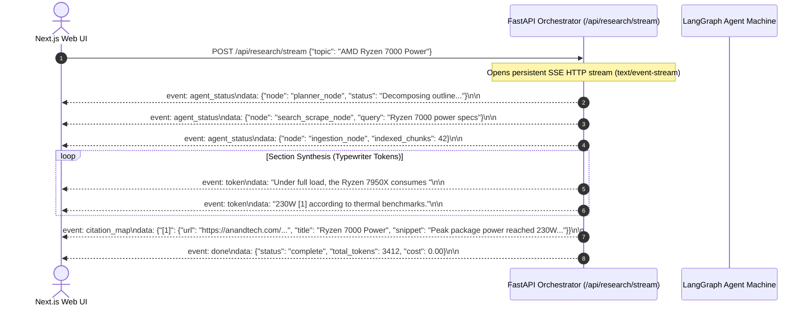
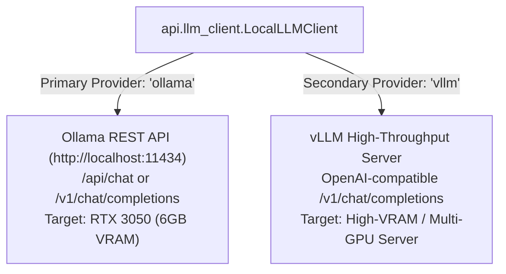
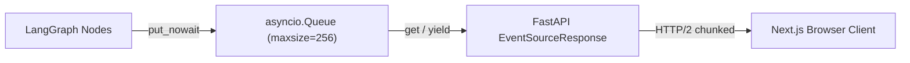

# Technical Explainer: FastAPI Server, Multi-Channel SSE Streaming & Dual-Engine LLM Client

This document breaks down the fundamental concepts, network streaming protocols, asynchronous concurrency models, and design rationale behind **Section 3.5 & Section 2 (FastAPI Server, Local Serving & SSE Streaming)** of DeepSearch-Local.

---

> [!NOTE]
> **Implementation Status: Phase 5 Placeholder**  
> While basic application setup and health check routing are scaffolded in `api/main.py`, the research streaming endpoints, agent-orchestrator bridges, and full LLM streaming client are scheduled for **Phase 5: FastAPI Streaming Backend & Next.js UI**. All unimplemented components in this document are explicitly marked with `[PLACEHOLDER - Phase 5]`.

---

## 1. The Core Architectural Challenge

An autonomous deep research agent does not behave like a standard chat assistant. While a chat completion completes in 1–3 seconds, a multi-step research run requires **60 to 180 seconds**, executing multiple sequential steps:
- Decomposing queries
- Executing searches across DuckDuckGo / SearXNG
- Scraping and extracting Markdown
- Offloading text to CPU embeddings in Qdrant
- Synthesizing sections iteratively
- Auditing gaps and reflecting

If the backend relies on traditional synchronous HTTP request-response (`POST /api/research` $\to$ wait 120s $\to$ return JSON), the user faces a frozen screen, HTTP connection timeouts drop the session, and there is zero visibility into agent reasoning.

The **API Layer** acts as the asynchronous bridge between the web dashboard and the background LangGraph state machine, providing:
1. **Real-time visibility** into state transitions and web queries.
2. **Typewriter-style token streaming** during section generation.
3. **Structured metadata streaming** for live interactive citations.

---

## 2. Multi-Channel Server-Sent Events (SSE) Architecture

### Why Server-Sent Events (SSE) Over WebSockets?
Many agent frameworks instinctively adopt WebSockets. However, an analysis of the communication requirements reveals that WebSockets introduce unnecessary operational complexity:

| Criterion | Server-Sent Events (SSE) | WebSockets (`ws://`) |
| :--- | :--- | :--- |
| **Directionality** | **Unidirectional (Server $\to$ Client)** | Bidirectional (Full Duplex) |
| **Transport** | **Standard HTTP/1.1 or HTTP/2** | Custom TCP upgrade handshake |
| **Reconnection** | **Built-in automatic browser reconnect** | Requires manual custom client logic |
| **Multiplexing** | **Natively multiplexed over HTTP/2** | Bypasses HTTP/2 connection pooling |
| **Firewall / Proxy** | **Passes through standard reverse proxies** | Frequently blocked by corporate firewalls |
| **Agent Suitability**| **Optimal:** The user sends one prompt; the agent streams dozens of events back. | Overkill: Client rarely sends mid-flight messages. |

### Multi-Channel Event Multiplexing
Standard SSE streams push raw text strings (`data: Hello world\n\n`). DeepSearch-Local defines a **typed multi-channel event protocol** over a single persistent SSE connection:



### SSE Protocol Envelopes [PLACEHOLDER - Phase 5]

#### 1. `event: agent_status`
Informs the Next.js UI of state machine progression, updating the Live Activity Drawer without altering document text:
```http
event: agent_status
data: {"node": "search_scrape_node", "queries": ["AMD Ryzen 7950X AVX-512 power draw"], "scraped_count": 4, "iteration": 1}

```

#### 2. `event: token`
Carries raw generation tokens directly from the 3B SLM during synthesis, allowing the frontend to render smooth typewriter-style animations:
```http
event: token
data: "Under AVX-512 stress tests, package power peaks at 230W."

```

#### 3. `event: citation_map`
Delivers structured citation metadata mapping sequential citation pills (`[1]`, `[2]`) to their source URLs, titles, and exact quoted snippets:
```http
event: citation_map
data: {"[1]": {"url": "https://example.com/review", "title": "Zen 4 Architecture Deep Dive", "snippet": "Peak power measured at socket was 230W under Prime95."}}

```

#### 4. `event: done`
Signals the successful termination of the research run, passing summary telemetry and resource consumption statistics:
```http
event: done
data: {"session_id": "session_8f2a1b", "wall_clock_seconds": 78.4, "iterations": 1, "cost_dollars": 0.0}

```

---

## 3. Dual-Engine Local LLM Client Abstraction

DeepSearch-Local provides a unified asynchronous client wrapper (`LocalLLMClient` in `api/llm_client.py`) capable of interfacing with local model serving runtimes:



### Asynchronous Streaming Generators
The client exposes an `AsyncIterator[str]` interface, decoupling token generation from network transport:

```python
class LocalLLMClient:
    """Unified client for interacting with locally hosted Ollama or vLLM instances."""

    async def stream_chat_completion(
        self,
        messages: List[Dict[str, str]],
        temperature: float = 0.2,
    ) -> AsyncIterator[str]:
        """Stream token responses via SSE."""
        # [PLACEHOLDER - Phase 5]
        # Uses httpx.AsyncClient to stream chunks from Ollama endpoint
```

### Temperature & Sampling Configuration
For deterministic agent behavior (strict JSON tool calling, reproducible outlines, and accurate citation tags), the client pins sampling parameters:
- `temperature = 0.2`: Prevents creative drift and token skipping.
- `top_p = 0.9`: Eliminates low-probability noise tokens from the probability tail.
- `stop = ["<|im_end|>", "<|endoftext|>"]`: Guarantees prompt boundary termination.

---

## 4. Asynchronous Concurrency & Backpressure

### The Backpressure Dilemma
During section synthesis, a 3B SLM running locally on an RTX 3050 produces tokens at **30–40 tokens per second**. If a remote web browser on high-latency mobile Wi-Fi cannot consume packets quickly enough:
- The TCP send buffer fills up.
- Unsent tokens accumulate in Python memory.
- If unmanaged, memory leaks can crash the FastAPI process.

### Asynchronous Queue Buffering
To prevent memory leaks and protect background LangGraph execution from slow network consumers, the streaming route implements **bounded asynchronous queue buffering**:



- When the buffer reaches capacity (`maxsize=256`), the generator throttles token retrieval until the client catches up.
- If the client drops the TCP connection (e.g. user closes the browser tab), the FastAPI generator detects `CancelledError`, signals the cancellation token to LangGraph, and gracefully purges the ephemeral Qdrant vector collection.

---

## 5. CORS & Application Security

Because the Next.js development server runs on `http://localhost:3000` while FastAPI runs on `http://localhost:8000`, the browser enforces Cross-Origin Resource Sharing (CORS) security checks.

### CORS Middleware Configuration (`api/main.py`)
```python
app.add_middleware(
    CORSMiddleware,
    allow_origins=["http://localhost:3000", "http://127.0.0.1:3000"],
    allow_credentials=True,
    allow_methods=["GET", "POST", "OPTIONS"],
    allow_headers=["*"],
    expose_headers=["Content-Type", "Cache-Control"],
)
```
- **Preflight Caching:** Browsers send an `OPTIONS` request before initiating the SSE stream. FastAPI handles preflights with zero latency overhead.
- **Cache-Control Headers:** SSE endpoints strictly return `Cache-Control: no-cache` and `X-Accel-Buffering: no` to prevent intermediate NGINX reverse proxies from buffering real-time streaming tokens.

---

## 6. Phase 5 Implementation Roadmap & Stubs Reference

The following API components are currently scaffolded or stubs awaiting Phase 5 implementation:

| Module Path | Current Status | Planned Phase 5 Implementation |
| :--- | :--- | :--- |
| `api/main.py` | Scaffolded (health check & CORS) | Register research streaming routers and lifespan context manager. |
| `api/llm_client.py` | Stub (`NotImplementedError`) | Implement async streaming client for Ollama `/api/chat` and vLLM `/v1/chat/completions`. |
| `api/routes/research.py` | **[PLACEHOLDER - Phase 5]** | Create `POST /api/research/stream` streaming endpoint using `EventSourceResponse`. |
| `api/routes/health.py` | Scaffolded (`/health`) | Add readiness probes checking Qdrant Docker health and Ollama model availability. |
| `api/routes/export.py` | **[PLACEHOLDER - Phase 5]** | Endpoints for server-side Markdown-to-PDF compilation and file downloads. |

---

## 7. Summary Jargon Cheat Sheet

| Jargon Term | Plain English Definition | Role in DeepSearch-Local |
| :--- | :--- | :--- |
| **Server-Sent Events (SSE)** | Unidirectional HTTP streaming protocol pushing text events from server to client. | Primary transport for streaming typewriter tokens and agent status to Next.js. |
| **EventSource** | Standard browser JavaScript API used to consume Server-Sent Events over HTTP. | Client interface in Next.js reading the research event stream. |
| **Multi-Channel Streaming** | Multiplexing different event types (`token`, `status`, `citations`) over one SSE stream. | Separates document text from agent state machine updates. |
| **Backpressure** | Resistance applied upstream when a consumer cannot process data as fast as it is produced. | Prevents high-speed local SLM token generation from bloating memory on slow connections. |
| **Typewriter Effect** | Rendering text one token at a time as it is generated rather than all at once. | Provides immediate feedback while the 3B SLM writes research reports. |
| **AsyncIterator** | Python protocol allowing asynchronous `async for` loops over a stream of data. | Interface used by `LocalLLMClient` to yield tokens dynamically. |
| **Dual-Engine Client** | Unified API abstraction interfacing seamlessly with either Ollama or vLLM. | Allows switching between consumer 6GB laptops (Ollama) and cloud servers (vLLM). |
| **CORS Preflight** | Preliminary `OPTIONS` HTTP request verifying cross-origin communication permissions. | Negotiates access between Next.js (`:3000`) and FastAPI (`:8000`). |
| **`X-Accel-Buffering`** | HTTP header telling NGINX proxies not to buffer streaming responses. | Guarantees instant per-token delivery without proxy buffering delays. |
