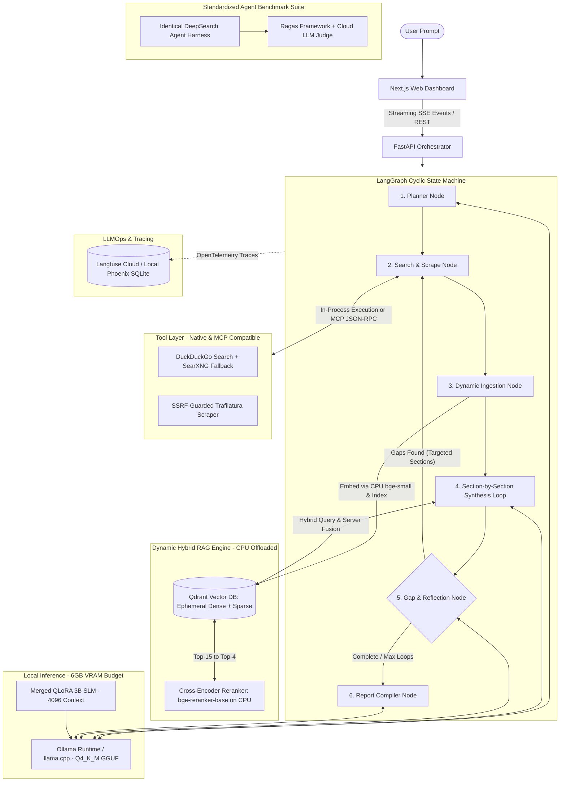

# Product Requirements Document (PRD)
## DeepSearch-Local: Autonomous Deep Research Agent Platform

---

### 1. Executive Summary

**DeepSearch-Local** is an open-source, local-first autonomous deep research platform designed to rival commercial systems such as *Perplexity Pro Search* and *OpenAI Deep Research*.

The platform operates efficiently on consumer-grade hardware (specifically optimized for an **NVIDIA RTX 3050 Laptop GPU with 6 GB VRAM** and 16 GB host RAM). It pairs a parameter-efficient fine-tuned (PEFT / QLoRA) **Small Language Model (SLM, 1.5B–3B parameters)** with a cyclic multi-step **LangGraph** agent, native in-process tool execution with optional Anthropic **Model Context Protocol (MCP)** interoperability, a dynamic **Qdrant Native Hybrid RAG** engine, and a **Next.js** interactive web dashboard.

The engineering core demonstrates a vital industry capability: **A domain-specialized 3B SLM, running with zero recurring cloud inference costs on consumer hardware, can match cloud models on structured JSON tool calling, outline generation, source grounding, and inline citation adherence within a bounded research domain.** Auxiliary embedding and reranking tasks are pinned to the CPU to guarantee that 100% of the GPU's 6 GB VRAM is reserved for the SLM.

---

### 2. Core Technical Architecture



---

### 3. Detailed Component Specifications

#### 3.1. Model Engineering & QLoRA Fine-Tuning Pipeline
* **Base Architecture:** Small Language Model (SLM, 1.5B–3B parameter range, such as `Qwen/Qwen2.5-3B-Instruct` or `meta-llama/Llama-3.2-3B-Instruct`).
* **Compute Constraints:** NVIDIA GeForce RTX 3050 Laptop GPU (6,144 MiB VRAM), CUDA 12.x/13.x.
* **Quantization Scheme:** 4-bit NormalFloat (NF4) via `bitsandbytes`, double quantization enabled, compute dtype `torch.bfloat16`.
* **LoRA Target Modules:** `q_proj`, `k_proj`, `v_proj`, `o_proj`, `gate_proj`, `up_proj`, `down_proj`.
* **Hyperparameters:**
  * Rank ($r$): 16
  * Alpha ($\alpha$): 32
  * Dropout: 0.05
  * Micro-batch size: 1
  * Gradient accumulation steps: 4
  * Effective batch size: 4
  * Max sequence length: **4,096 tokens** (aligned with inference context length)
  * Optimizer: `paged_adamw_8bit` (CPU/GPU paging to avoid VRAM spikes)
  * Gradient checkpointing: Enabled
  * Target VRAM consumption during training: **4.8 GB to 5.4 GB** (leaving safety margin for system display buffers).
* **Synthetic Data Generation Strategy:**
  * Uses an automated Python generator script via OpenRouter (leveraging frontier models) to synthesize **3,000–5,000 instruction-tuning trajectories** (with 1,000 as a minimal quick-start baseline; estimated one-time generation cost ~$5 to $15) across 4 specific tasks:
    1. *Query Decomposition (25%):* Multi-query generation from ambiguous research prompts.
    2. *Tool Calling & Argument Parsing (25%):* Valid JSON schema adherence and error-recovery trajectories.
    3. *Grounded Synthesis (35%):* Fact extraction and inline citation formatting (`[^chunk_id]`).
    4. *Gap Detection & Reflection (15%):* Identifying missing data, formulating targeted follow-up queries, and specifying sections requiring revision.

#### 3.2. Tool Layer: Native Execution & Model Context Protocol (MCP)
* **Execution Model:** Internal LangGraph nodes execute tools **natively in-process** using Python functions for zero-overhead, deterministic execution. A standalone Anthropic MCP JSON-RPC server is also provided to expose the same tools to external clients (e.g., Claude Desktop, Cursor).
* **Search Backend:**
  * Primary: DuckDuckGo search library (`duckduckgo-search`) with retry logic and exponential backoff to handle rate limits.
  * Fallback: Self-hosted SearXNG instance or Tavily API fallback to prevent complete research pipeline stalls upon DDG IP rate limiting.
* **Scraper Engine:**
  * Async HTTP client (`httpx` + `trafilatura` / `BeautifulSoup4`) extracting clean markdown, removing HTML scripts, styles, headers, and navigation menus.
  * **SSRF Protection:** Strict IP validation rejecting private/internal networks (`127.0.0.0/8`, `10.0.0.0/8`, `172.16.0.0/12`, `192.168.0.0/16`, `169.254.0.0/16`, and `localhost`) to protect local containers (Qdrant, Ollama, host OS) from malicious redirects.
* **Exposed Tools:**
  * `web_search(query: str, max_results: int = 5) -> List[SearchResult]`
  * `fetch_page_markdown(url: str) -> str`
  *(Note: Draft state management is handled natively within LangGraph state transitions, not via an external tool).*

#### 3.3. Dynamic Hybrid RAG Engine (CPU-Offloaded)
* **Hardware Pinning:** Embedding and Re-Ranking models are strictly pinned to **CPU / ONNX Runtime**, preserving 100% of GPU VRAM for the 3B SLM.
* **Vector Store:** Qdrant (deployed as an isolated Docker container with local volume persistence).
* **Collection Strategy:** Ephemeral per-session collections generated via UUID, indexed on the fly as web pages are scraped, and pruned upon session completion.
* **Dense Embedding Model:** `BAAI/bge-small-en-v1.5` (dense embeddings, 384 dimensions, executed on CPU via `fastembed` or ONNX).
* **Sparse Lexical Search:** Qdrant native sparse vectors with built-in BM25 tokenization.
* **Hybrid Fusion:** Qdrant server-side Prefetch and Reciprocal Rank Fusion (RRF, $k=60$) or Distribution-Based Score Fusion directly within the database engine, eliminating custom in-memory BM25 indexing in Python.
* **Text Chunking:** Deterministic recursive character chunking (512 tokens with 64-token overlap) with heading metadata tagging (avoiding the quadratic sentence-embedding latency of local semantic chunking).
* **Re-Ranking:** Lightweight cross-encoder (`BAAI/bge-reranker-base`) executed on CPU, evaluating the top-15 fused chunks down to the top-4 most semantically and lexically relevant passages.

#### 3.4. Agent Orchestration: LangGraph Cyclic State Machine
* **Framework:** `langgraph` (v0.2+) with `pydantic` v2 state validation and channel reducers.
* **State Schema:**
  ```python
import operator
from typing import Annotated, Any, Dict, List, Optional
from pydantic import BaseModel, Field

class ResearchState(BaseModel):
    research_topic: str
    outline: List[str] = Field(default_factory=list)
    search_queries: Annotated[List[str], operator.add] = Field(default_factory=list)
    scraped_urls: Annotated[List[str], operator.add] = Field(default_factory=list)
    evidence_chunks: Annotated[List[Dict[str, Any]], operator.add] = Field(default_factory=list)
    sections: Dict[str, str] = Field(default_factory=dict)
    sections_to_revise: List[str] = Field(default_factory=list)
    unresolved_gaps: List[str] = Field(default_factory=list)
    iteration_count: int = 0
    max_iterations: int = 2
    final_report: Optional[str] = None
  ```
* **Graph Topology:**
  1. `planner_node`: Generates structured multi-section outline and initial search queries.
  2. `search_scrape_node`: Executes search and scraping tools, deduplicating against `scraped_urls`.
  3. `ingestion_node`: Splits text via recursive chunking, generates embeddings on CPU, and indexes chunks into the ephemeral Qdrant collection.
  4. `synthesis_loop`: Iteratively drafts sections against the outline. For each section, retrieves top-4 hybrid chunks, prompting the SLM to write cited section text using temporary chunk IDs (`[^chunk_hash]`).
  5. `reflection_node`: Audits drafts against the outline. If information gaps exist and `iteration_count < max_iterations`:
     - Identifies missing facts.
     - Sets `sections_to_revise` with specific section names.
     - Increments `iteration_count`.
     - Routes back to `search_scrape_node` with targeted queries.
     Otherwise, routes to `compiler_node`.
  6. `compiler_node`: Consolidates all sections, normalizes temporary citation hashes into sequential numerical markers (`[1]`, `[2]`), generates the unified bibliography with source URLs and titles, and produces `final_report`.

#### 3.5. Local Serving & Inference Engine
* **Primary Engine: Ollama / `llama.cpp`:**
  * Merged model weights + LoRA adapter exported to 4-bit (`Q4_K_M`) GGUF via `llama.cpp`.
  * Served locally via Ollama with `PARAMETER num_ctx 4096` and `PARAMETER stop ["<|im_end|>", "<|endoftext|>"]`.
  * Total runtime VRAM consumption: **~2.8 GB to 3.2 GB** (including 4,096-token KV cache), operating well within the 6 GB hardware limit.
* **Secondary / Server Engine (Optional):** vLLM is supported as an optional deployment path strictly for high-VRAM headless environments ($\ge 16$ GB VRAM).
* **API Client:** OpenAI-compatible client wrapper in FastAPI (`/v1/chat/completions`).
* **Streaming Protocol:** Two-channel Server-Sent Events (SSE) streaming to the Next.js UI:
  * `event: token`: Raw generation tokens for live typing.
  * `event: agent_status`: JSON payloads reporting current node, search queries, URLs scraped, and iteration progress.
  * `event: citation_map`: Structured JSON mapping temporary chunk IDs and numerical citations (`[1]`) to source metadata (URL, title, quoted passage).

#### 3.6. LLM Observability & Tracing (LLMOps)
* **Platform:** Dual-mode tracing support:
  * **Option A (Default Local / Low-RAM):** Embedded local tracing via **Arize Phoenix** (SQLite-backed, minimal memory footprint) or Langfuse Cloud free-tier endpoint.
  * **Option B (Dockerized Self-Hosted):** Full Langfuse Docker stack (Langfuse Server + PostgreSQL), recommended only on systems with $\ge 16$ GB host RAM.
* **Instrumentation:** Automatic LangGraph tracing via OpenTelemetry / Langfuse callback handler.
* **Monitored Telemetry:**
  * Full multi-step DAG trace graphs.
  * Node-level latency breakdown (Planner vs. Search vs. Synthesis vs. Reflection).
  * Prompt and completion token counts.
  * Operational cost monitoring ($0.00 for local SLM vs. cloud baseline equivalents).

#### 3.7. Next.js Web Dashboard
* **Framework:** Next.js 14+ (App Router), TypeScript, Tailwind CSS, shadcn/ui.
* **Key Views:**
  * **Research Input View:** Topic input with depth/breadth configuration.
  * **Agent Activity Drawer:** Live visualization of LangGraph state (current node, queries executed, URLs being processed, reflection loop counter).
  * **Document Viewer:** Real-time markdown rendering with KaTeX math and tables.
  * **Interactive Citations:** Numbered citation pills (`[1]`) that trigger interactive popovers displaying source URL, title, and exact quoted snippet (populated dynamically from the SSE `citation_map` stream).
  * **Export Suite:** One-click "Export to Markdown" and "Print/Export to PDF".
  * **Trace Link:** Direct hyperlink to the specific Phoenix or Langfuse execution trace.

---

### 4. Evaluation & Benchmarking Framework

To validate the research hypothesis without confounding variables, the automated evaluation harness runs all candidate models through the **identical DeepSearch Agent harness** across 25 diverse research topics:

| Evaluation Target | Model Configuration | Inference Location | Agent Harness |
| :--- | :--- | :--- | :--- |
| **Baseline 1** | Base SLM (Zero-Shot / Instruct) | Local (RTX 3050 - Ollama) | DeepSearch LangGraph Agent |
| **Baseline 2** | Llama 3.3 70B / GPT-4o-mini | Cloud (via OpenRouter API) | DeepSearch LangGraph Agent |
| **Our System** | **Fine-Tuned 3B SLM (QLoRA)** | **Local (RTX 3050 - Ollama)** | **DeepSearch LangGraph Agent** |

#### Evaluated Metrics (Ragas & TruLens with Cloud LLM Judge):
An external frontier judge model (`gpt-4o` or `claude-3-5-sonnet`) evaluates the output runs across:
1. **Faithfulness (Hallucination Detection):** Ratio of claims in generated reports directly verifiable from retrieved source URLs.
2. **Citation Precision:** Percentage of `[X]` citation markers that accurately support the immediate preceding sentence.
3. **Outline Coverage:** Percentage of original research outline sub-questions answered in the final text.
4. **Tool Execution Success Rate:** Percentage of generated tool calls with 100% valid JSON syntax on first pass.
5. **Inference Latency & Total Compute Cost:** Comparison of end-to-end wall-clock time and cost per research report.

---

### 5. Repository File Structure

```
deepsearch-local/
├── docker-compose.yml              # Orchestrates Qdrant and optional local telemetry
├── README.md                       # Architecture diagram, benchmark results, setup guide
├── .env.example                    # Environment variables (endpoints, fallbacks)
│
├── agent/                          # LangGraph State Machine
│   ├── __init__.py
│   ├── graph.py                    # Cyclic state graph topology & conditional routing
│   ├── state.py                    # Pydantic state definition with Annotated reducers
│   ├── nodes/                      # Planner, Search, Ingest, Synth (loop), Reflection, Compiler
│   └── prompts/                    # System prompts & structured tool templates
│
├── mcp_server/                     # Standalone Model Context Protocol Server (External Interop)
│   ├── __init__.py
│   ├── server.py                   # JSON-RPC MCP server
│   └── tools/                      # DuckDuckGo/SearXNG search & SSRF-guarded scraper
│
├── rag/                            # Dynamic Hybrid RAG Pipeline (CPU Offloaded)
│   ├── __init__.py
│   ├── vector_store.py             # Qdrant client & ephemeral collection manager
│   ├── hybrid_retriever.py         # Native Qdrant dense + sparse search with server-side RRF
│   └── reranker.py                 # CPU-optimized cross-encoder reranking wrapper
│
├── finetuning/                     # Local QLoRA Pipeline (RTX 3050 6GB)
│   ├── generate_synthetic_data.py  # OpenRouter synthetic trajectory generator (3,000-5,000 samples)
│   ├── train_qlora.py              # 4-bit PEFT / TRL training script (4096 context, paged AdamW)
│   ├── merge_and_export.py         # Adapter merge & GGUF conversion script
│   └── configs/                    # Training arguments & LoRA hyperparameters
│
├── api/                            # FastAPI Server
│   ├── __init__.py
│   ├── main.py                     # Entrypoint & CORS configuration
│   ├── routes/                     # Research endpoints & multi-channel SSE streaming
│   └── llm_client.py               # Standardized Ollama / OpenAI-compatible client
│
├── eval/                           # Benchmark & Validation Suite
│   ├── run_benchmark.py            # Automated test runner across models on identical agent harness
│   ├── test_dataset.json           # 25 complex research benchmark prompts
│   └── ragas_evaluator.py          # Ragas evaluator with Cloud LLM Judge
│
└── web/                            # Next.js Frontend Dashboard
    ├── package.json
    ├── app/                        # Next.js App Router (layout, page)
    ├── components/                 # Chat bar, AgentDrawer, ReportViewer, Citations
    └── lib/                        # Multi-event SSE stream consumer & API helpers
```

---

### 6. Implementation Milestones

* **Phase 1: Environment Setup & Tool Plane**
  * Configure Docker Compose for Qdrant and lightweight telemetry.
  * Implement in-process search and scraping tools with SSRF guardrails and DDG backoff.
  * Expose tools through standalone MCP JSON-RPC server for external client compatibility.
* **Phase 2: CPU-Offloaded Dynamic Hybrid RAG**
  * Implement Qdrant ephemeral collection manager with native dense and sparse indexing.
  * Implement CPU-based embedding (`bge-small-en-v1.5`) and cross-encoder re-ranking (`bge-reranker-base`).
* **Phase 3: Synthetic Dataset & QLoRA Fine-Tuning**
  * Generate 3,000–5,000 synthetic trajectories via OpenRouter across query decomposition, tool syntax, synthesis, and reflection.
  * Train 3B SLM with 4-bit QLoRA at 4,096 context length on RTX 3050 using `paged_adamw_8bit`.
  * Merge adapter and export to `Q4_K_M` GGUF; verify inference and KV-cache stability in Ollama.
* **Phase 4: LangGraph Agent Orchestration & Self-Correction**
  * Construct cyclic state graph with section-by-section synthesis loop and targeted reflection.
  * Implement sequential citation normalization and bibliography compilation in `compiler_node`.
  * Wire OpenTelemetry callbacks for end-to-end tracing.
* **Phase 5: FastAPI Streaming Backend & Next.js UI**
  * Implement multi-channel SSE streaming (`token`, `agent_status`, `citation_map`) in FastAPI.
  * Build Next.js interface with real-time markdown, live graph drawer, and popover citations.
* **Phase 6: Standardized Benchmarking & Validation**
  * Execute Ragas benchmark suite comparing Base SLM vs. Cloud 70B vs. Fine-Tuned 3B SLM inside the identical agent harness.
  * Evaluate faithfulness, citation precision, tool syntax validity, latency, and cost with a cloud LLM judge.
  * Document findings and publish benchmark report in README.
