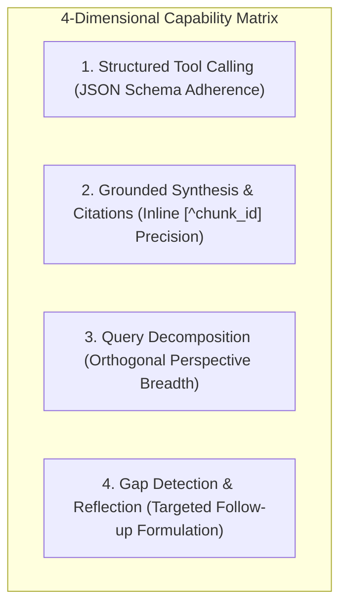
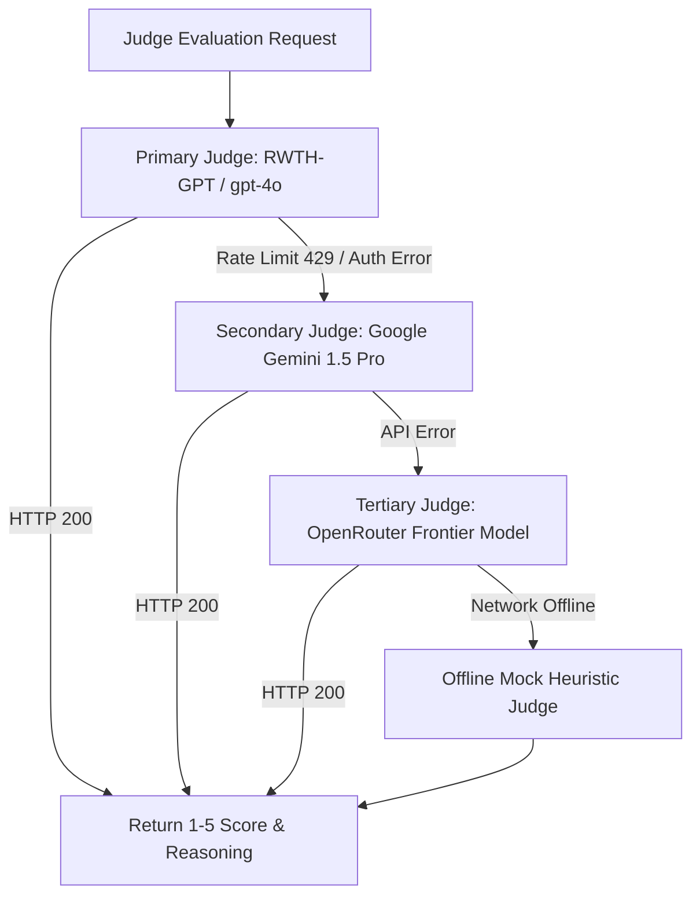
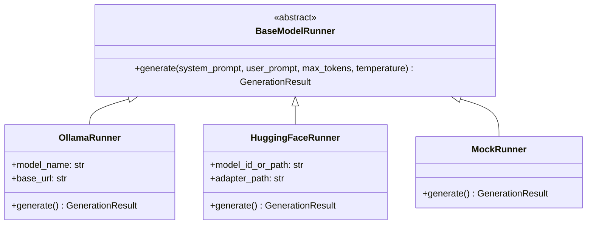
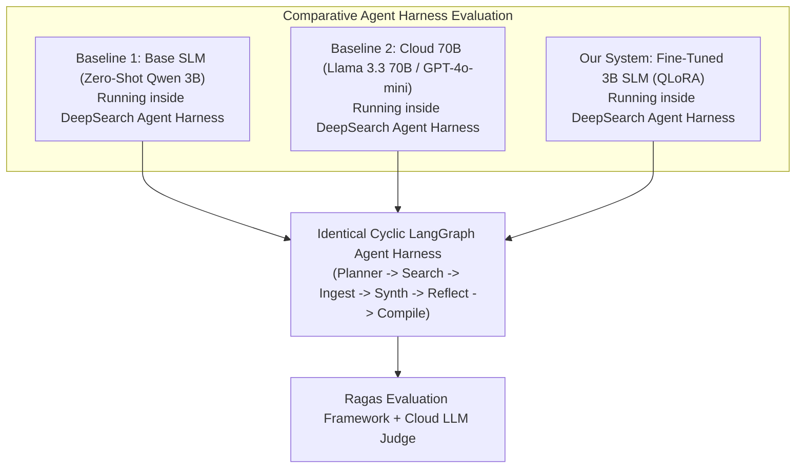

# Technical Explainer: Agent Evaluation, LLM-as-a-Judge, Ragas & Benchmark Suite

This document breaks down the fundamental concepts, evaluation metrics, judge scoring rubrics, and benchmarking methodology behind **Section 4 & Section 6 Phase 6 (Evaluation & Benchmarking Framework)** of DeepSearch-Local.

---

> [!NOTE]
> **Implementation Status: Phase 6 Placeholder (Full Agentic Harness)**  
> While standalone single-turn task evaluation scripts (`eval/run_benchmark.py`, `eval/metrics.py`, `eval/llm_judge.py`) were created to evaluate the fine-tuned checkpoint on isolated synthetic prompts, the **full Phase 6 end-to-end agent harness evaluation** (evaluating multi-turn LangGraph cycles, live web scraping, and Ragas report faithfulness across 25 full topics) is scheduled for **Phase 6: Standardized Benchmarking & Validation** following Phase 4 agent completion. Unimplemented end-to-end components in this document are explicitly marked with `[PLACEHOLDER - Phase 6]`.

---

## 1. The Core Evaluation Challenge: Why Traditional NLP Metrics Fail

Evaluating an autonomous deep research agent requires fundamentally different methodologies than standard machine translation or conversational chatbots:

### Why BLEU and ROUGE Fail
- **N-gram Overlap Fallacy:** Traditional metrics like **BLEU** or **ROUGE** measure word n-gram overlap between generated text and a reference summary.
- If an agent conducts deep research on an emerging topic (e.g. new battery chemistries) and discovers a novel factual paper not present in the reference text, BLEU severely penalizes the model for discovering new, true facts simply because the words do not match the static reference.

### Why Perplexity Fails
- **Perplexity ($\mathcal{P} = \exp(-\mathcal{L})$)** measures the probability distribution of tokens. A model can generate syntactically flawless text with low perplexity while hallucinating citations, outputting invalid JSON schemas, or omitting entire sections of the requested outline.

To evaluate an autonomous research agent rigorously, DeepSearch-Local implements a **two-tier evaluation framework**:
1. **Tier 1 (Deterministic Syntactic & Citational Verification):** Strict regex, JSON AST parsers, and citation bracket extractors.
2. **Tier 2 (Semantic LLM-as-a-Judge & Ragas):** Frontier cloud models evaluating multi-turn factual grounding, outline completeness, and hallucination penalties.

---

## 2. The Four-Dimensional Agent Capability Matrix

DeepSearch-Local benchmarks models across the 4 foundational tasks required by the LangGraph control plane:



| Dimension | Primary Failure Mode in Base SLMs | Success Criteria in Fine-Tuned SLM | Verification Mechanism |
| :--- | :--- | :--- | :--- |
| **1. Tool Calling** | Emits markdown conversational preamble (`"Here is the tool you asked for:"`), escapes quotes incorrectly, or produces invalid JSON. | Emits **raw, valid JSON** conforming 100% to schema with valid argument typing. | Deterministic `json.loads` + AST extraction (`eval/metrics.py`) |
| **2. Grounded Synthesis** | Hallucinates plausible-sounding facts, cites non-existent sources, or invents citation formats. | Extracts facts **strictly from provided chunks** and cites with verbatim tags (`[^chunk_id]`). | Citation regex extractor + Hallucination verification |
| **3. Query Decomposition** | Generates overlapping/duplicate queries (e.g., "Ryzen power", "Ryzen wattage", "Ryzen electricity"). | Decomposes topic into **3–5 orthogonal search angles** (architecture, idle, peak load, benchmarks). | Orthogonal semantic distance & LLM Judge rubric |
| **4. Gap Reflection** | Claims research is complete when major outline sections lack evidence; asks generic follow-ups. | Identifies **specific missing facts**, names target sections, and formulates targeted queries. | Gap extraction + Outline coverage scoring |

---

## 3. Tier 1: Deterministic Syntactic & Citation Verification Metrics

Implemented in `eval/metrics.py`, Tier 1 executes with zero cloud cost and sub-millisecond latency.

### 1. Robust JSON Extraction Pipeline
Models often wrap tool calls in markdown fences or append conversational pleasantries. `extract_json_payload` applies a 3-stage fallback:
1. Direct `json.loads(text)`
2. Markdown fenced codeblock extraction (`re.search(r"```(?:json)?\s*([\s\S]*?)\s*```")`)
3. Outermost brace scanning (`text[first_brace : last_brace + 1]`)

### 2. Syntactic Tool Evaluation (`evaluate_tool_calling`)
Evaluates:
- `is_valid_json`: True if successfully parsed.
- `has_valid_schema`: True if top-level dictionary contains `"name"` (or `"tool"`) and `"arguments"`.
- `is_allowed_tool`: True if tool name belongs to `{"web_search", "fetch_page_markdown"}`.

### 3. Citation Verification Metrics (`evaluate_grounded_synthesis`)
Extracts all inline citation tags matching `r"\[\^([a-zA-Z0-9_-]+)\]"`:
- **Citation Count:** Total number of citation tags emitted.
- **Valid Citation Ratio:** Percentage of emitted tags that map to actual chunks provided in the input context.
- **Unsupported Claims:** Flagged sentences followed by citations to non-existent chunk hashes.

$$\text{Citation Precision} = \frac{\sum \text{Valid Context Citations}}{\sum \text{Total Citations Emitted}}$$

---

## 4. Tier 2: LLM-as-a-Judge Architecture

While syntactic checks confirm JSON syntax and citation tags, verifying semantic depth, query orthogonality, and synthesis faithfulness requires reasoning. DeepSearch-Local employs an **automated LLM-as-a-Judge pipeline** (`eval/llm_judge.py`).

### Multi-Tier Fallback Judge (`FallbackJudge`)
To ensure benchmark runs never fail due to API rate limits or network outages, the judge implements automatic cascading fallbacks:



### Pairwise Comparison Rubric
The judge evaluates baseline responses (`response_base`) against fine-tuned responses (`response_ft`) across identical prompts:
- Assigns a discrete score from **1.0 (Fail)** to **5.0 (Exemplary)**.
- Selects a categorical winner: `"finetuned"`, `"base"`, or `"tie"`.
- Emits detailed natural language reasoning justifying the decision.

---

## 5. Model Runner Architecture: Local GGUF vs. Local PyTorch vs. Cloud

The evaluation harness abstracts model inference through `eval/model_runner.py`:



### 1. `OllamaRunner` (Primary Production Benchmark)
- Queries local Ollama daemon via `/api/chat` or `/v1/chat/completions`.
- Runs the exported `Q4_K_M` GGUF model on the **RTX 3050 Laptop GPU**.
- Benchmarks real-world latency, measuring wall-clock generation time and tokens per second ($tok/s$).

### 2. `HuggingFaceRunner` (Direct PyTorch/PEFT Verification)
- Loads unmerged base model in 4-bit NormalFloat (NF4) and attaches LoRA adapters via `PeftModel`.
- Directly measures raw model behavior without GGUF quantization drift.

### 3. `MockRunner` (CI/CD Testing)
- Generates deterministic simulated responses without GPU or network access.
- Used in automated GitHub Actions and unit tests (`tests/test_eval_suite.py`).

---

## 6. Phase 6 Full Agent Benchmark Suite [PLACEHOLDER - Phase 6]

In the complete Phase 6 milestone (following Phase 4 agent orchestration), the evaluation harness moves beyond isolated prompts to benchmark the **entire cyclic LangGraph agent harness** across 25 diverse research topics (`eval/test_dataset.json`):



### Evaluated Agentic Metrics [PLACEHOLDER - Phase 6]:
1. **Faithfulness (Hallucination Detection):**
   $$\text{Faithfulness} = \frac{|\text{Verifiable Claims in Generated Report}|}{|\text{Total Claims in Generated Report}|}$$
   Measures whether claims in the compiled final report can be directly verified against the web chunks retrieved into the ephemeral Qdrant store.
2. **Citation Precision:**
   Measures the percentage of sequential citation pills (`[1]`, `[2]`) in the compiled text that accurately support the immediate preceding sentence.
3. **Outline Coverage:**
   $$\text{Outline Coverage} = \frac{|\text{Outline Sub-Questions Answered}|}{|\text{Total Sub-Questions Planned}|}$$
4. **Tool Execution Success Rate:**
   Percentage of agent tool calls executed with 100% valid JSON syntax on the first pass (zero parser crashes).
5. **Inference Latency & Total Compute Cost:**
   Total wall-clock runtime and operational cost per report ($0.00 for local SLM vs. cloud equivalents).

---

## 7. Phase 6 Implementation Roadmap & Stubs Reference

The following components represent the current state and Phase 6 implementation roadmap:

| Module Path | Current Status | Planned Phase 6 Implementation |
| :--- | :--- | :--- |
| `eval/metrics.py` | Implemented (Tier 1 metrics) | Add Ragas faithfulness and multi-turn claim verification extractors. |
| `eval/llm_judge.py` | Implemented (Multi-tier judge) | Add end-to-end report evaluation rubrics for full research dossiers. |
| `eval/model_runner.py` | Implemented (Ollama, HF, Mock) | Wire runner directly into LangGraph agent node executors. |
| `eval/ragas_evaluator.py` | Scaffolded | **[PLACEHOLDER - Phase 6]** Connect Ragas `evaluate()` to compiled agent reports. |
| `eval/run_benchmark.py` | Implemented for single-turn tasks | **[PLACEHOLDER - Phase 6]** Add `--mode agent` to execute full LangGraph loops across 25 topics. |
| `eval/test_dataset.json` | 25 Research prompts | Expand reference answers and gold-standard evaluation outlines. |

---

## 8. Summary Jargon Cheat Sheet

| Jargon Term | Plain English Definition | Role in DeepSearch-Local |
| :--- | :--- | :--- |
| **LLM-as-a-Judge** | Using an advanced frontier model (GPT-4o, Sonnet) to evaluate model outputs. | Provides automated, scalable semantic evaluation of synthesis quality. |
| **Faithfulness Score** | Ratio of statements in an answer that can be inferred directly from the context. | Core metric in Phase 6 ensuring reports do not contain hallucinated facts. |
| **Citation Precision** | Percentage of citation markers that accurately support the immediate preceding claim. | Ensures `[1]` and `[^chunk_id]` tags point to true source evidence. |
| **Outline Coverage** | Ratio of user outline questions successfully addressed in the final text. | Verifies the agent followed the research plan without omitting topics. |
| **Ragas** | Open-source framework for reference-free evaluation of RAG pipelines. | Used in Phase 6 to quantify faithfulness and answer relevancy. |
| **Multi-Tier Fallback** | Cascading architecture trying primary API, then secondary, then mock heuristics. | Guarantees evaluation benchmarks never crash due to API rate limits. |
| **Gold Standard Dataset** | Hand-curated or frontier-distilled set of reference prompts and expected behaviors. | `eval/test_dataset.json` (25 complex research topics). |
| **Orthogonal Decomposition**| Breaking a topic into non-overlapping, independent research perspectives. | Evaluation dimension verifying search queries cover distinct angles. |
| **Mock Runner** | Deterministic model runner generating canned responses without GPU or APIs. | Enables instant unit testing of evaluation metrics in CI/CD environments. |
| **AST JSON Parser** | Parser extracting valid JSON objects from markdown text or raw string streams. | `extract_json_payload` ensuring tool calling scores reflect true syntax validity. |
