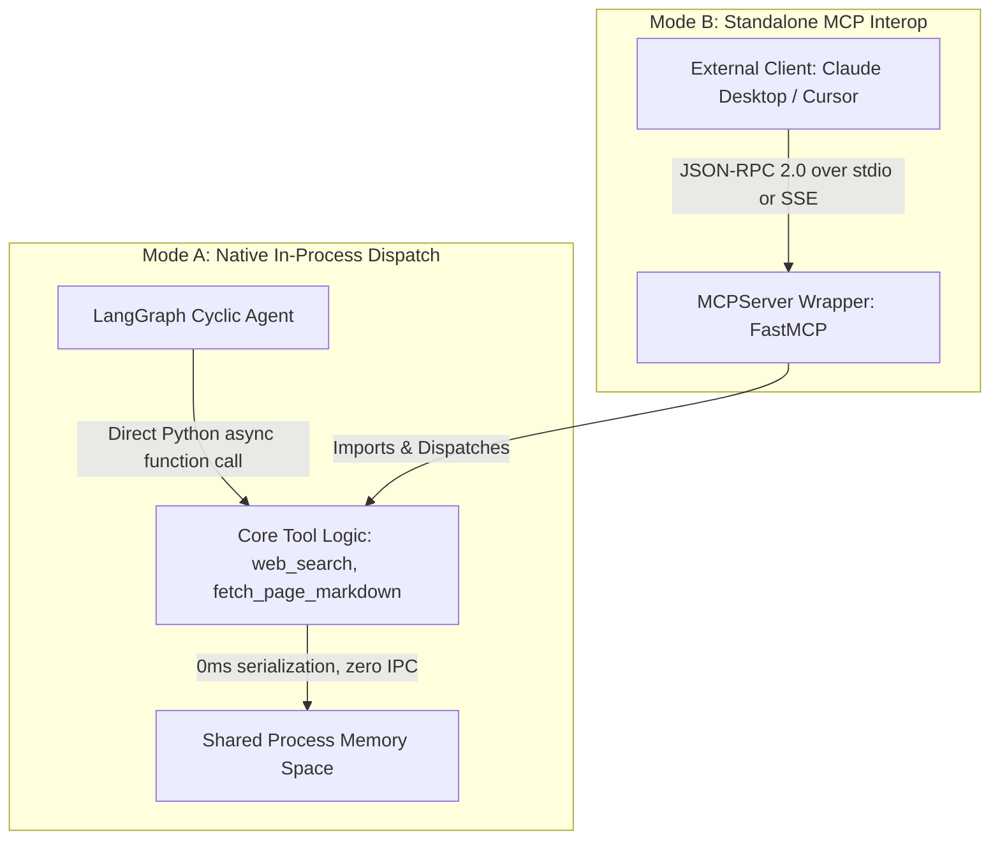
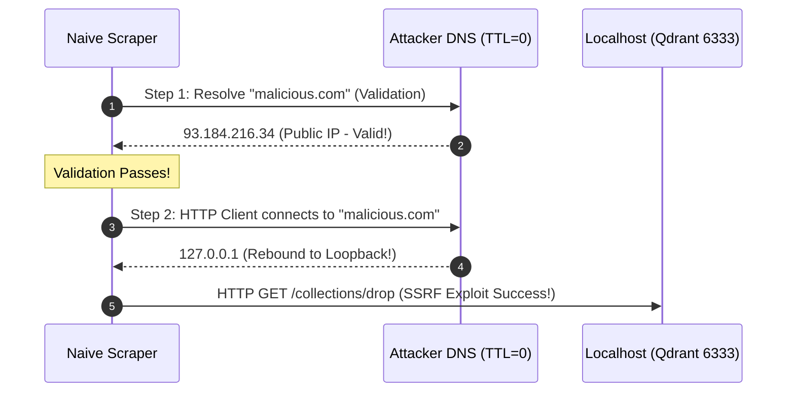
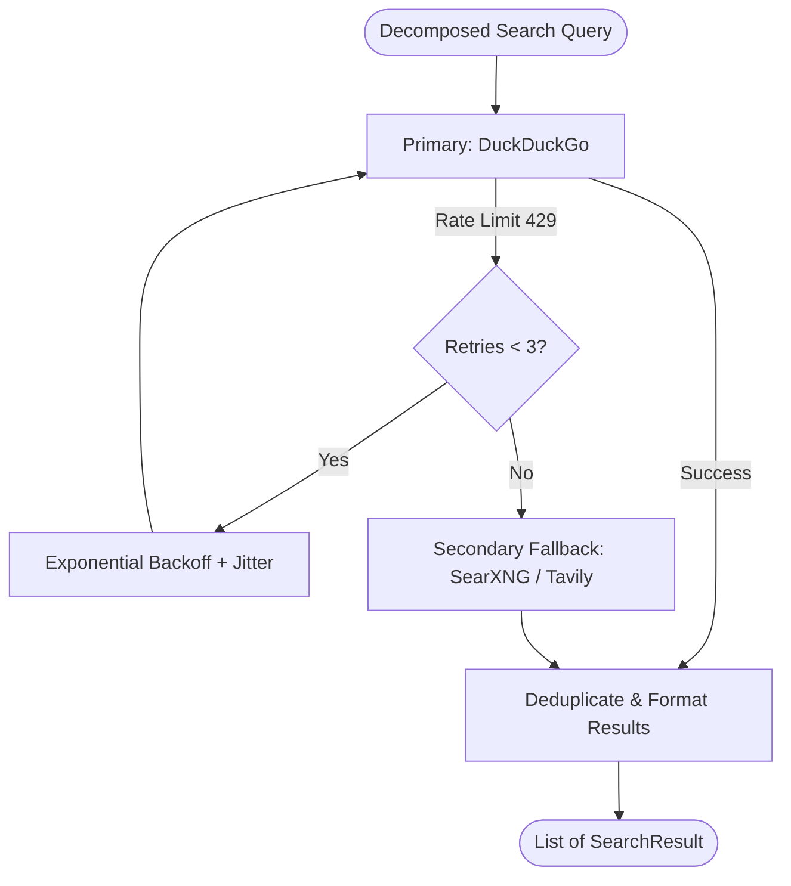
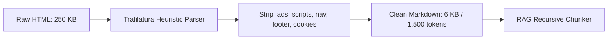

# Technical Explainer: Tool Layer, SSRF Security, Web Search & Model Context Protocol (MCP)

This document breaks down the fundamental concepts, networking protocols, security algorithms, and design rationale behind **Section 3.2 (Tool Layer: Native Execution & Model Context Protocol)** of DeepSearch-Local.

---

## 1. The Core Architectural Challenge

An autonomous deep research agent cannot rely solely on parametric memory. A 3-Billion parameter Small Language Model (SLM) trained on historical weights will inevitably hallucinate or present stale facts when queried about recent scientific breakthroughs, changing hardware specifications, or niche technical documentation.

The **Tool Layer** functions as the agent's sensory organs, providing external grounding via web discovery and document scraping. However, executing autonomous network operations introduces two severe engineering challenges:

1. **The In-Process vs. Inter-Process Communication (IPC) Latency Dilemma:**
   Cyclic agent workflows (such as LangGraph) may execute 15–30 tool calls per research task. If tools run across network sockets or serial pipes, serialization latency compounds, stalling agent execution.
2. **The Server-Side Request Forgery (SSRF) Attack Vector:**
   Allowing an autonomous model to fetch arbitrary URLs extracted from the public web creates critical vulnerability. A malicious web page can return redirects pointing to internal infrastructure:
   - The local Qdrant vector database (`http://localhost:6333`)
   - The local Ollama model engine (`http://localhost:11434`)
   - Cloud instance metadata endpoints (`http://169.254.169.254/latest/meta-data/`)
   - Host intranet services (`http://192.168.1.1/admin`)

To resolve this, DeepSearch-Local employs a **dual-dispatch execution architecture** paired with **hardened, pre-resolution defense-in-depth SSRF protection**.

---

## 2. Dual-Execution Architecture: Native In-Process vs. Standalone MCP

A frequent antipattern in modern agent systems is forcing internal agent loops to communicate with their own tools over local sockets or IPC pipes.

DeepSearch-Local decouples tool logic into standalone pure-Python modules that can be consumed in two distinct modes:



### Latency Arithmetic & Transport Trade-offs

| Transport Layer | Serialization Mechanism | Typical Round-Trip Overhead | Failure Modes | DeepSearch-Local Role |
| :--- | :--- | :--- | :--- | :--- |
| **Native In-Process** | Direct Python memory references | **$< 0.001\text{ ms}$** | Direct Python exceptions | **Default agent engine:** Zero latency penalty during multi-step research loops |
| **MCP stdio** | JSON-RPC 2.0 via standard streams (`stdin`/`stdout`) | **$0.5\text{--}2.0\text{ ms}$** | Broken OS pipes, deadlocks on unbuffered output | **External interop:** Seamless hook into Claude Desktop, Cursor, or CLI agents |
| **MCP SSE** | HTTP Server-Sent Events + POST endpoints | **$3.0\text{--}12.0\text{ ms}$** | TCP socket drops, port collisions | **Remote interop:** Headless or containerized tool plane deployment |

---

## 3. The Model Context Protocol (MCP 2.x)

### What is the Model Context Protocol?
The **Model Context Protocol (MCP)** is an open standard developed by Anthropic that standardizes how AI applications connect to external data sources and tools. Rather than writing custom integration code for every client, MCP defines a client-host-server topology.

```
┌──────────────────┐               ┌──────────────────┐
│    MCP Client    │  JSON-RPC 2.0 │    MCP Server    │
│ (Claude / Cursor)│◄─────────────►│(DeepSearch Tools)│
└──────────────────┘  stdio / SSE  └────────┬─────────┘
                                            │
                                            ▼
                               ┌──────────────────────────┐
                               │ web_search               │
                               │ fetch_page_markdown      │
                               └──────────────────────────┘
```

### JSON-RPC 2.0 Protocol Envelope
MCP relies on JSON-RPC 2.0 specification. Tool discovery and execution follow a standard request-response handshake:

#### 1. Tool Discovery (`tools/list`):
```json
{
  "jsonrpc": "2.0",
  "id": 1,
  "method": "tools/list"
}
```
The server reflects Python type annotations and docstrings into JSON Schema:
```json
{
  "jsonrpc": "2.0",
  "id": 1,
  "result": {
    "tools": [
      {
        "name": "web_search",
        "description": "Execute a web search using DuckDuckGo...",
        "inputSchema": {
          "type": "object",
          "properties": {
            "query": { "type": "string" },
            "max_results": { "type": "integer", "default": 5 }
          },
          "required": ["query"]
        }
      }
    ]
  }
}
```

#### 2. Tool Execution (`tools/call`):
```json
{
  "jsonrpc": "2.0",
  "id": 2,
  "method": "tools/call",
  "params": {
    "name": "web_search",
    "arguments": { "query": "Qwen 2.5 3B QLoRA benchmark", "max_results": 3 }
  }
}
```

---

## 4. Hardened SSRF Defense-in-Depth

### What is Server-Side Request Forgery (SSRF)?
In SSRF, an attacker induces a server application to make HTTP requests to an arbitrary domain chosen by the attacker. In DeepSearch-Local, because scraped web pages can embed malicious URLs or issue HTTP redirects, a malicious actor could probe the local host or internal network.

### The Attack Surface
```
Public Web Page -> Redirect: http://127.0.0.1:6333/collections/session_xxx/delete
                 -> Redirect: http://169.254.169.254/latest/meta-data/iam/credentials
                 -> Redirect: http://192.168.1.1/router-config.backup
```

### Comprehensive CIDR Range Filtering
DeepSearch-Local's `mcp_server/tools/ssrf.py` enforces strict subnet isolation using Python's `ipaddress` library against both IPv4 and IPv6:

```python
BLOCKED_NETWORKS = [
    # IPv4 Private & Loopback
    ipaddress.ip_network("127.0.0.0/8"),      # Loopback / Localhost
    ipaddress.ip_network("10.0.0.0/8"),       # RFC 1918 Class A Private
    ipaddress.ip_network("172.16.0.0/12"),    # RFC 1918 Class B Private
    ipaddress.ip_network("192.168.0.0/16"),   # RFC 1918 Class C Private
    ipaddress.ip_network("169.254.0.0/16"),   # RFC 3927 Link-Local / Cloud Metadata
    ipaddress.ip_network("0.0.0.0/8"),        # This host / Broadcast
    ipaddress.ip_network("100.64.0.0/10"),    # RFC 6598 Carrier-Grade NAT
    ipaddress.ip_network("198.18.0.0/15"),    # Benchmark testing
    ipaddress.ip_network("224.0.0.0/4"),      # Multicast
    ipaddress.ip_network("240.0.0.0/4"),      # Reserved for future use
    # IPv6 Private & Loopback
    ipaddress.ip_network("::1/128"),          # IPv6 Loopback
    ipaddress.ip_network("fc00::/7"),         # IPv6 Unique Local Address (ULA)
    ipaddress.ip_network("fe80::/10"),        # IPv6 Link-Local Unicast
]
```

### IPv4-Mapped IPv6 Bypasses
Attackers often attempt to bypass naive regex checks by supplying IPv4 addresses mapped inside IPv6 syntax:
`http://[::ffff:127.0.0.1]:8000/`

DeepSearch-Local unwraps mapped addresses before verification:
```python
if isinstance(ip, ipaddress.IPv6Address) and ip.ipv4_mapped:
    ip = ip.ipv4_mapped  # Unwraps to IPv4Address('127.0.0.1')
```

### DNS Rebinding & TOCTOU (Time-of-Check to Time-of-Use)
A naive SSRF check resolves the IP once, verifies it is public, and then lets `httpx` fetch the URL:
1. `validate_url("attacker.com")`: DNS resolves to `93.184.216.34` (Safe). Check passes.
2. `httpx.get("http://attacker.com")`: Attacker's DNS server has a TTL of 0 seconds. On the second lookup, DNS resolves to `127.0.0.1`. The HTTP client connects to `localhost`!



### DeepSearch-Local's Defense: Pre-Resolution & Redirect Auditing
DeepSearch-Local solves TOCTOU DNS Rebinding through strict socket pre-resolution and per-hop redirect validation:
1. Resolves all `A` and `AAAA` records using `socket.getaddrinfo`.
2. Inspects every returned IP against `BLOCKED_NETWORKS`.
3. Disables automatic client redirects (`follow_redirects=False`).
4. Audits each redirect `Location` header in a manual loop, ensuring that every intermediate target passes complete SSRF re-validation before connection.

---

## 5. Search Resilience: Rate Limits & Exponential Backoff

### DuckDuckGo Throttling
DeepSearch-Local uses `duckduckgo-search` as its default search backend because it requires zero API keys, enabling fully self-contained local operation. However, DuckDuckGo aggressively rate-limits automated requests, returning HTTP 429 or empty result sets.

### Exponential Backoff with Full Jitter
To prevent thundering herd problems and recover from transient IP blocks, `mcp_server/tools/search.py` implements exponential backoff with full jitter:

$$T_{\text{sleep}} = \text{Uniform}\left(0, \min(T_{\text{max}}, T_{\text{base}} \times 2^{\text{attempt}})\right)$$

Where:
- $T_{\text{base}} = 1.0\text{ s}$
- $T_{\text{max}} = 10.0\text{ s}$
- $\text{attempt} \in \{0, 1, 2\}$

```
Attempt 0: Wait 0.0s - 1.0s
Attempt 1: Wait 0.0s - 2.0s
Attempt 2: Wait 0.0s - 4.0s
Attempt 3: Trigger Secondary Fallback
```

### Multi-Tier Search Fallback
If DuckDuckGo fails after 3 consecutive backoff retries, the tool automatically routes to a secondary provider:
- **Primary:** DuckDuckGo (Free, zero-config)
- **Secondary (Self-Hosted):** SearXNG (`http://localhost:8080`)
- **Secondary (Cloud API):** Tavily API (`https://api.tavily.com`)



---

## 6. Content Extraction Pipeline & Token Economics

### The Problem with Raw HTML
A modern web page contains 80% boilerplate: JavaScript bundles, CSS stylesheets, navigation headers, sidebar links, advertising trackers, and SVG icons.
- Raw HTML of a standard tech blog: **~250 KB (50,000+ tokens)**.
- DeepSearch SLM Context Window: **4,096 tokens**.

Feeding raw HTML directly into a 3B SLM would overflow the context window on a single page and exhaust all GPU VRAM.

### The Trafilatura Extraction Engine
`fetch_page_markdown` leverages `trafilatura` (backed by an lxml C-parser) with a `BeautifulSoup4` fallback.



### Extraction Pipeline Mechanics
1. **Fetch:** `httpx.AsyncClient` downloads raw HTML under a strict 15-second timeout and 100,000-character safety ceiling.
2. **Body Extraction:** Trafilatura analyzes the DOM tree using text-to-tag ratios, extracting only the substantive article content.
3. **Markdown Conversion:** Tables, headings (`#`, `##`), bullet points, and code blocks are preserved; raw HTML tags are converted to standard Markdown.
4. **Fallback:** If Trafilatura fails (e.g. non-standard XML or dynamic DOMs), BeautifulSoup extracts text with tag-level noise stripping.

---

## 7. Summary Jargon Cheat Sheet

| Jargon Term | Plain English Definition | Role in DeepSearch-Local |
| :--- | :--- | :--- |
| **Model Context Protocol (MCP)** | Open standard by Anthropic connecting AI agents to tools via JSON-RPC. | Allows DeepSearch tools to be shared with Claude Desktop and external IDEs. |
| **FastMCP** | High-level Python framework for building MCP servers with minimal boilerplate. | Implements the CLI and stdio server in `mcp_server/server.py`. |
| **JSON-RPC 2.0** | Stateless, lightweight remote procedure call specification encoded in JSON. | Wire protocol used by MCP over `stdio` and `sse` transports. |
| **In-Process Dispatch** | Invoking Python functions directly within the same memory space ($0\text{ ms}$ IPC). | Default execution mode for LangGraph agent nodes to eliminate latency. |
| **SSRF** | Server-Side Request Forgery; an attack tricking a server into accessing internal resources. | Guarded against by `mcp_server/tools/ssrf.py` to prevent attacks on Qdrant/Ollama. |
| **TOCTOU** | Time-of-Check to Time-of-Use; race condition where state changes between validation and execution. | Mitigated by socket pre-resolution and IP pinning during HTTP requests. |
| **DNS Rebinding** | Attack where a domain's IP switches from public to private between checks. | Defeated by validating every resolved `A`/`AAAA` record and disabling auto-redirects. |
| **IPv4-Mapped IPv6** | Hybrid notation embedding an IPv4 address into IPv6 (`::ffff:127.0.0.1`). | Explicitly unwrapped and blocked before IP range evaluation. |
| **Exponential Backoff** | Algorithm increasing wait time exponentially between consecutive failed requests. | Prevents pipeline stalls when DuckDuckGo returns HTTP 429 rate limits. |
| **Full Jitter** | Introducing random uniform noise into backoff intervals. | Prevents concurrent agent queries from hitting the search engine simultaneously. |
| **Trafilatura** | C-optimized Python scraper extracting main body text from web pages. | Strips navigation/ads, reducing 50,000 HTML tokens to 1,500 Markdown tokens. |
| **Link-Local Address** | IP range (`169.254.0.0/16`) reserved for network segment communication and cloud metadata. | Strictly blocked to protect cloud instance metadata credentials. |
