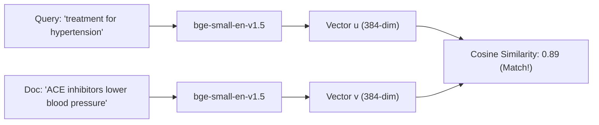
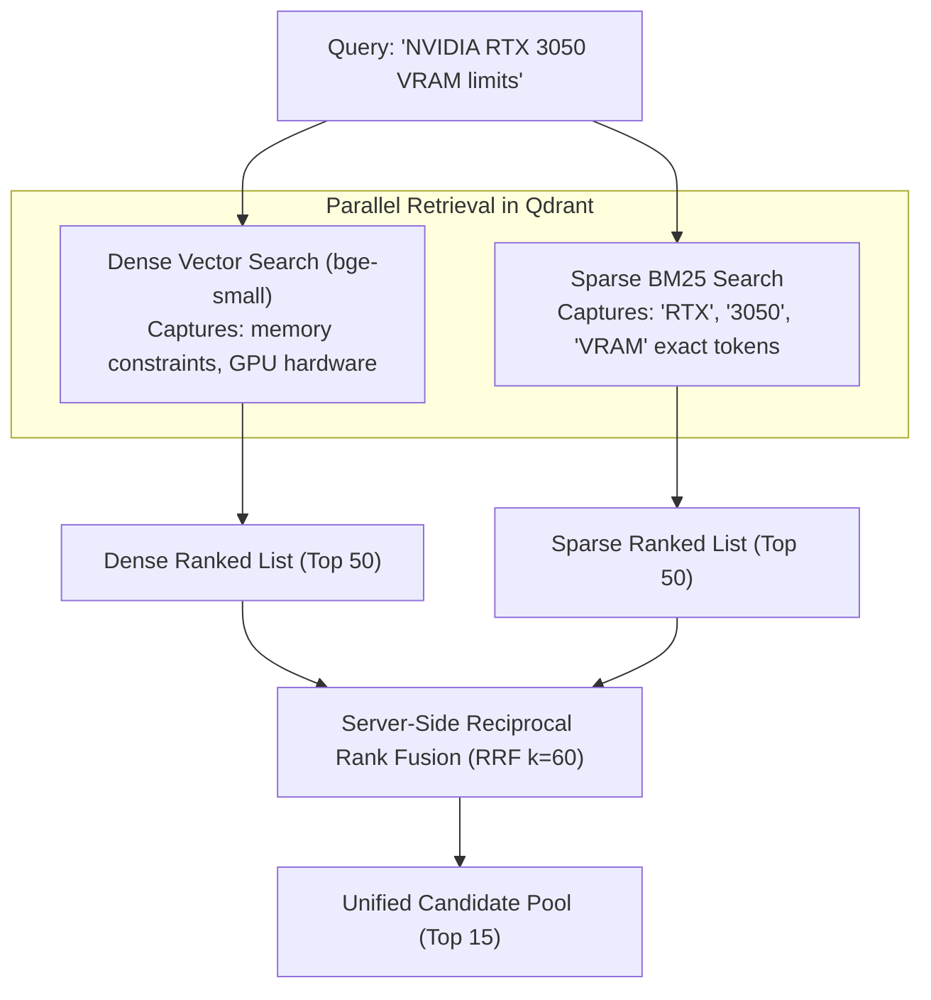
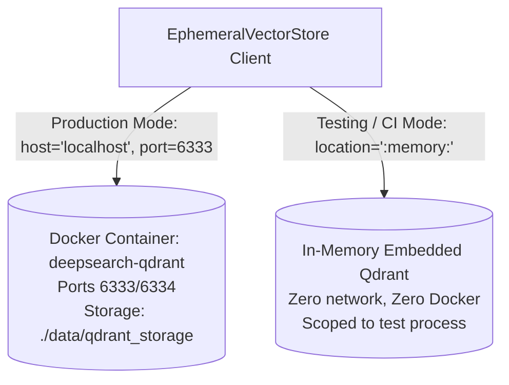

# Technical Explainer: Hybrid RAG, BM25, Embeddings & Reranking

This document breaks down the fundamental concepts, algorithms, mathematical foundations, and design rationale behind **Section 3.3 (Dynamic Hybrid RAG Engine)** of DeepSearch-Local.

---

## 1. The Core Architectural Challenge

DeepSearch-Local operates under a strict consumer hardware budget: an **NVIDIA GeForce RTX 3050 Laptop GPU with 6 GB VRAM** and 16 GB host RAM.

```
+-------------------------------------------------------------------+
| Total GPU VRAM: 6,144 MiB (RTX 3050 Laptop)                       |
+-------------------------------------------------------------------+
| [Reserved: 3B SLM Weights (Q4_K_M)]               ~ 2,000 MiB    |
| [Reserved: 4,096-Token KV Cache]                  ~ 1,000 MiB    |
| [Reserved: CUDA Context & OS Display Buffers]     ~ 1,200 MiB    |
| [Safety Margin / Fragmented Memory]               ~ 1,800 MiB    |
+-------------------------------------------------------------------+
| AVAILABLE GPU VRAM FOR EMBEDDINGS & RERANKER:          0 MiB     |
+-------------------------------------------------------------------+
```

If embedding models or cross-encoders run on the GPU, PyTorch will allocate CUDA memory pools, immediately triggering Out-Of-Memory (OOM) errors or forcing Ollama to evict KV caches to CPU RAM, degrading token generation speed from 35 tok/s to <3 tok/s.

Therefore, **the entire RAG retrieval pipeline (Embedding, Sparse Indexing, Vector Search, and Cross-Encoder Re-Ranking) is strictly CPU-offloaded**.

---

## 2. Dense Embeddings & Vector Representations

### What is a Dense Embedding?
A dense embedding model converts raw human text into a continuous, dense numerical vector:

$$\mathbf{v} = f(\text{text}) \in \mathbb{R}^d$$

Where $d$ is the dimensionality (e.g., $d = 384$). Unlike sparse representations where most values are zero, dense vectors have non-zero floating-point numbers in nearly every dimension. Each dimension captures latent semantic features learned during self-supervised pre-training.

### Bi-Encoder Architecture
Dense retrieval relies on a **Bi-Encoder** architecture:
- The query $q$ and document chunk $d$ are passed through the transformer model **independently**.
- The similarity between query and document is calculated using Cosine Similarity or Dot Product:

$$\text{sim}(q, d) = \frac{\mathbf{u} \cdot \mathbf{v}}{\|\mathbf{u}\|_2 \|\mathbf{v}\|_2}$$

Because documents can be embedded offline and stored in an index (e.g., HNSW in Qdrant), searching millions of chunks requires only calculating dot products against pre-computed vectors.



### Why `BAAI/bge-small-en-v1.5`?
| Criterion | `bge-small-en-v1.5` | `all-MiniLM-L6-v2` | `text-embedding-3-small` | `bge-large-en-v1.5` |
| :--- | :--- | :--- | :--- | :--- |
| **Dimensions ($d$)** | **384** | 384 | 1536 | 1024 |
| **Model Size** | **~133 MB** | ~90 MB | Cloud API | ~1.34 GB |
| **MTEB Retrieval Score**| **51.68** | 41.95 | 62.3 (approx) | 54.29 |
| **Inference Runtime** | **CPU / ONNX (<15ms)**| CPU (<12ms) | Cloud Latency | CPU (~90ms, slow) |
| **Self-Hosted / Free** | **Yes** | Yes | No (\$0.02/1M tokens)| Yes |

`bge-small-en-v1.5` hits the optimal sweet spot for CPU execution: it achieves near-large-model retrieval accuracy on standard benchmarks while requiring only 384 floating point operations per vector comparison and under 150 MB of host RAM.

### Failure Modes of Dense Retrieval:
- **Lexical blindness:** Cannot reliably match exact product model codes (e.g., `RTX 3050 vs RTX 3060`), software versions (`v0.2.20`), or uncommon acronyms.
- **Semantic drift:** A query like *"How to prevent SQL injection in Go"* may retrieve articles about *"SQL injection prevention in PHP"* because their dense vector representations are conceptually identical.

---

## 3. Sparse Lexical Search & Okapi BM25

### What is Sparse Retrieval?
Sparse retrieval represents text as high-dimensional vectors where the dimensionality equals the entire vocabulary size ($|\mathcal{V}| \approx 30,000\text{--}100,000$), and only dimensions corresponding to words actually present in the text have non-zero weights.

### The Okapi BM25 Algorithm
BM25 (Best Matching 25) is an advanced probabilistic ranking function that improves upon basic TF-IDF (Term Frequency-Inverse Document Frequency).

For a query $Q$ with terms $q_1, q_2, \dots, q_n$ and document $D$:

$$\text{score}(D, Q) = \sum_{i=1}^{n} \text{IDF}(q_i) \cdot \frac{f(q_i, D) \cdot (k_1 + 1)}{f(q_i, D) + k_1 \cdot \left(1 - b + b \cdot \frac{|D|}{\text{avgdl}}\right)}$$

Where:
- $f(q_i, D)$: Raw term frequency of word $q_i$ in document $D$.
- $|D|$ and $\text{avgdl}$: Length of document $D$ and average document length across the collection.
- $\text{IDF}(q_i) = \ln \left( \frac{N - n(q_i) + 0.5}{n(q_i) + 0.5} + 1 \right)$: Inverse Document Frequency, penalizing ubiquitous words like "the" or "is" and rewarding rare discriminative words like "QLoRA" or "Trafilatura".
- $k_1$ (typically $1.2\text{--}1.5$): **Term frequency saturation parameter**. It limits how much repeating a word increases the score. In plain TF, 20 occurrences give $20\times$ weight; in BM25, it asymptotically flattens.
- $b$ (typically $0.75$): **Document length normalization**. Penalizes long documents that contain the word simply because they have more words overall.

```
BM25 Score Curve vs Term Frequency
Score
  ^            BM25 (k1=1.5) [Saturates asymptotically]
  |          . - - - - - - - - - - - - - - - -
  |        /
  |       /
  |      /    Standard TF (Linear) [Vulnerable to keyword stuffing]
  |     /   /
  |    /  /
  |   / /
  +--------------------------------------------> Term Frequency (f)
```

### Strengths & Failure Modes of BM25:
- **Strengths:** Exact keyword matching, identifier matching, zero training required, highly resistant to semantic hallucination.
- **Failure Modes:** Vocabulary mismatch (synonym failure: query for "cardiac arrest" will miss a document stating "heart attack").

---

## 4. Hybrid Search & Fusion: Combining Both Worlds

Neither Dense nor Sparse search is sufficient on its own. Hybrid search runs **both** queries concurrently and merges their ranked outputs.



### Reciprocal Rank Fusion (RRF)
How do you merge results when Dense distance (e.g. Cosine score $0.78$) and BM25 score (e.g. $14.32$) operate on completely different, non-comparable scales?

Standard normalization (Min-Max) is fragile to outlier spikes. **Reciprocal Rank Fusion (RRF)** solves this by using only the **rank positions** of items, discarding raw score values:

$$\text{RRF\_Score}(d) = \sum_{m \in M} \frac{1}{k + r_m(d)}$$

Where:
- $M$: The set of retrieval systems ($M = \{\text{Dense}, \text{BM25}\}$).
- $r_m(d)$: The 1-based rank position of document $d$ in system $m$. If the document is not in system $m$'s top results, $r_m(d) \to \infty$ (contribution is $0$).
- $k$: Smoothing constant (industry standard: **$k = 60$**).

#### Why is $k = 60$?
If $k=1$, rank 1 gets score $\frac{1}{2} = 0.50$, and rank 2 gets $\frac{1}{3} = 0.33$. The top item dominates excessively.
With $k = 60$:
- Rank 1: $\frac{1}{61} \approx 0.01639$
- Rank 2: $\frac{1}{62} \approx 0.01612$
- Rank 10: $\frac{1}{70} \approx 0.01428$

This smooth curve ensures that an item appearing at Rank 5 in **both** Dense and Sparse will outscore an item appearing at Rank 1 in Dense but missing entirely from Sparse, promoting consensus between semantic meaning and exact keyword presence.

### Server-Side Qdrant Prefetch vs. Python-Side Merging
Instead of pulling 50 dense results and 50 sparse results into Python over HTTP/gRPC and executing RRF in Python:
- **Qdrant Server-Side Prefetch:** Qdrant executes both dense and sparse retrieval in its Rust engine, applies RRF natively on the server, and returns only the fused Top-15 directly over the wire. This cuts serialization latency by >70%.

---

## 5. Two-Stage Retrieval & Cross-Encoder Re-Ranking

Retrieving candidates is only the first half of high-accuracy RAG. The second half is **Cross-Encoder Re-Ranking**.

```
Candidate Funnel:
[All Scraped Documents: 1,000+ chunks]
             |
             v  (Hybrid Dense + BM25 Prefetch: < 30ms on CPU)
[Top-15 Fused Candidates]
             |
             v  (Cross-Encoder Re-Ranking: ~100ms on CPU)
[Top-4 Citational Passages -> Delivered to 3B SLM]
```

### Bi-Encoder vs. Cross-Encoder

```mermaid
flowchart TD
    subgraph BiEncoder_Retrieval [Stage 1: Bi-Encoder (bge-small)]
        Q1[Query] --> Enc1[Encoder] --> V1[Vec Q]
        D1[Document] --> Enc2[Encoder] --> V2[Vec D]
        V1 & V2 --> Cosine["Dot Product\nO(1) comparison, No cross-attention"]
    end
    
    subgraph CrossEncoder_Rerank [Stage 2: Cross-Encoder (bge-reranker-base)]
        QD["Combined: [CLS] Query [SEP] Document [SEP]"] --> FullTrans["Full Multi-Head Self-Attention across all tokens"]
        FullTrans --> Score["Relevance Logit (0.0 to 1.0)"]
    end
```

| Feature | Bi-Encoder (`bge-small-en-v1.5`) | Cross-Encoder (`bge-reranker-base`) |
| :--- | :--- | :--- |
| **Input Structure** | Query and Document encoded separately | Query and Document concatenated as single input |
| **Attention** | Independent self-attention | Full cross-attention between every query token and document token |
| **Speed** | Extremely fast (embeddings pre-computed) | Slow ($O(N \cdot L^2)$ computation for $N$ candidates) |
| **Scoring Quality** | Coarse / Approximate semantic similarity | High-precision logical and citational relevance |
| **Use Case** | Searching full corpus (1000s of chunks $\to$ Top 15) | Precision filtering (Top 15 $\to$ Top 4) |

### Why `BAAI/bge-reranker-base`?
- **Parameters:** ~110M parameters.
- **CPU Latency:** Scoring 15 candidate passages takes $\approx 90\text{--}130$ ms on a modern multi-core CPU.
- **Impact on 3B SLM:** A 3B parameter model has a 4,096-token context window. Feeding 15 chunks (~7,500 tokens) would overflow the context window and dilute attention ("lost in the middle" effect). Filtering down to the Top-4 highest-scoring passages (~2,000 tokens) leaves ample room for the system prompt, outline, and generated response.

---

## 6. Text Chunking & Heading Metadata Tagging

### Why Deterministic Recursive Chunking?
1. **Semantic Chunking:** Computes embeddings between consecutive sentences and splits when distance crosses a threshold. While elegant, it requires dozens of embedding calls per scraped article, taking 2–4 seconds of CPU time per page.
2. **Recursive Character Chunking:** Splits deterministically by Markdown hierarchy:
   `["\n\n", "\n", " ", ""]`.
   - Chunk size: **512 tokens** (~2,048 characters).
   - Overlap: **64 tokens** (~256 characters) to prevent information loss across boundaries.

### Heading Metadata Tagging
When a web page has nested sections, chunking text in isolation causes context loss:
```markdown
# AMD Ryzen 7000 Series
## Power Consumption
Under full load, it consumes 170W.
```
If chunked naively, Chunk 2 only reads: *"Under full load, it consumes 170W"*. The retriever cannot know what "it" refers to.

**Heading Metadata Tagging** injects the parent breadcrumb hierarchy into the chunk payload:
```python
{
    "text": "Under full load, it consumes 170W.",
    "metadata": {
        "heading_path": "AMD Ryzen 7000 Series > Power Consumption",
        "url": "https://example.com/hardware-review",
        "title": "Hardware Review 2026",
    },
}
```
When indexed, the heading breadcrumb is prepended to the indexed text: `[Context: AMD Ryzen 7000 Series > Power Consumption] Under full load, it consumes 170W.` This guarantees high semantic match fidelity for both dense and sparse retrieval.

---

## 7. Vector Store: Ephemeral Session Collections

### What is an "Ephemeral" Collection?
The word **ephemeral** means *temporary, short-lived, or transient*. 

In standard enterprise RAG, a vector database typically maintains one massive, persistent collection containing millions of documents (such as an entire company knowledge base or wiki). That collection lives indefinitely and is updated continuously.

In contrast, **DeepSearch-Local creates an isolated, disposable collection for each individual research query**, denoted by a unique session UUID:
`collection_name = f"session_{uuid4().hex[:12]}"`

This collection is spun up dynamically on the fly, populated with chunks scraped specifically for that research topic, queried during report drafting, and **completely purged from the vector database once the final report is compiled**.

```mermaid
sequenceDiagram
    autonumber
    actor User as User / Prompt
    participant Agent as LangGraph Orchestrator
    participant Chunker as Markdown Chunker
    participant FastEmbed as FastEmbed (CPU ONNX)
    participant Qdrant as Qdrant Vector Store
    
    User->>Agent: "Research RTX 3050 vs RX 6600 for SLMs"
    Agent->>Qdrant: 1. create_session_collection("session_a8f9c21b")
    Note over Qdrant: Fresh HNSW + Sparse Inverted Indices Created
    Agent->>Agent: Search Web & Scrape 15 Pages
    Agent->>Chunker: Split HTML/Markdown into 512-token chunks
    Agent->>FastEmbed: Generate 384d Dense + BM25 Sparse Vectors
    Agent->>Qdrant: 2. add_documents(session_id, chunks)
    Note over Qdrant: Indexed ~150 chunks for this topic only
    loop Section-by-Section Synthesis
        Agent->>Qdrant: 3. Server-side Prefetch + RRF Hybrid Retrieval
        Qdrant-->>Agent: Top-15 Fused Chunks
        Agent->>Agent: Rerank to Top-4 via Cross-Encoder & Draft Section
    end
    Agent->>Agent: Compile Final Report with Citations
    Agent->>Qdrant: 4. delete_session_collection("session_a8f9c21b")
    Note over Qdrant: Ephemeral collection dropped; RAM/disk reclaimed
```

### Why Use Ephemeral Collections Instead of One Shared Collection?

| Problem in Shared / Monolithic Collections | How Ephemeral Collections Solve It |
| :--- | :--- |
| **Cross-Topic Contamination & Hallucination:** If Session 1 researched "Quantum Computing" and Session 2 researches "Baking Sourdough", a shared vector space can surface quantum physics terms when querying bread recipes. | **100% Strict Boundary Isolation:** Session 2 can only ever see sources retrieved for Session 2. Hallucination risk from past searches is mathematically zero. |
| **BM25 IDF Distortion:** BM25 IDF scores depend on corpus frequencies. In a massive multi-topic database, rare technical words lose their discriminative power. | **Topic-Specific IDF Accuracy:** The BM25 inverse document frequencies are computed strictly across the 10–25 pages scraped for this exact topic, maximizing lexical precision. |
| **Metadata Filtering Overhead:** Querying a 1M-chunk collection with `filter={"session_id": "xyz"}` incurs payload lookup penalties and index degradation. | **Blazing-Fast Search Latency:** Searching an isolated index of ~150 chunks takes < 2 ms on CPU, avoiding graph traversal across millions of irrelevant points. |
| **Disk & RAM Accumulation:** A deep research agent scraping 50 pages per query would bloat vector storage by hundreds of megabytes per day. | **Instant Zero-Cost Cleanup:** Dropping `session_a8f9c21b` is an $O(1)$ database operation that immediately frees memory and disk. |

### Lifecycle Management & Safeguards
1. **Normal Flow (Context Manager):** Managed via `with EphemeralVectorStore.session(session_id):` or explicit deletion in `compiler_node`.
2. **Abnormal Termination (Crash Safeguard):** If a user halts execution (Ctrl+C), or if an unhandled network error kills the process before `compiler_node`, the vector store provides a janitor routine:
   ```python
   vector_store.cleanup_stale_collections(max_age_minutes=60)
   ```
   This routine inspects all collections prefixed with `session_`, checks the creation timestamp embedded in their metadata, and drops any session older than 60 minutes.

---

## 8. FastEmbed & ONNX Runtime: CPU Vectorization & Zero-CUDA Isolation

### What is ONNX Runtime?
**ONNX (Open Neural Network Exchange)** is an open format built to represent machine learning models independently of the framework they were trained in (PyTorch, TensorFlow, JAX).

**ONNX Runtime** is a high-performance C++ inference engine developed by Microsoft. Instead of loading the entire PyTorch runtime (which is multi-gigabyte and designed for training), ONNX Runtime focuses purely on inference:
- Uses CPU hardware vector extensions (**AVX-512, AVX2, FMA, ARM NEON**) to perform matrix multiplications directly on CPU registers with maximum throughput.
- Strips away gradient graphs, autograd engines, and training overhead.

### What is FastEmbed?
**FastEmbed** is a lightweight Python library developed by Qdrant specifically for fast, low-latency CPU embedding generation.

| Metric | PyTorch (`sentence-transformers`) | FastEmbed (`onnxruntime` + Rust tokenizers) |
| :--- | :--- | :--- |
| **Dependencies** | PyTorch (~2.5 GB on disk) | `onnxruntime` + `tokenizers` (<100 MB) |
| **RAM Footprint** | ~500 MiB to 1.2 GiB | **~150 MiB** |
| **Model Cold-Start** | 2.5 – 4.0 seconds | **< 150 ms** |
| **CUDA Contention Risk**| **High** (PyTorch can lazily allocate CUDA context) | **Zero** (compiled with CPU Execution Provider) |
| **Supported Tasks** | Dense, Cross-Encoder | **Dense (`bge-small`), Sparse (`bm25`), Cross-Encoder (`bge-reranker`)** |

### Why FastEmbed is Critical for DeepSearch-Local
On a laptop with an **RTX 3050 (6 GB VRAM)**, if a Python script imports `torch` and initializes a model, PyTorch frequently initializes CUDA driver contexts, claiming 300 to 800 MiB of VRAM just for runtime bookkeeping. If that happens, Ollama's 3B SLM (which requires ~3.2 GB with its 4,096-token KV cache) will suffer memory fragmentation or crash with CUDA OOM.

FastEmbed runs exclusively via the ONNX CPU Execution Provider. It cannot touch CUDA VRAM, guaranteeing that **100% of the GPU's 6 GB VRAM remains isolated for the SLM**.

---

## 9. Configurable Dual-Mode: Docker `localhost:6333` vs. `:memory:` Fallback

### What is Dual-Mode?
DeepSearch-Local's `EphemeralVectorStore` supports two operating modes under the same Python interface:



### 1. Production Mode (`http://localhost:6333`)
- **How it works:** Connects to the standalone Qdrant server running inside Docker (specified in `docker-compose.yml`).
- **Storage:** Persisted in `./data/qdrant_storage` with Write-Ahead Logging (WAL) and memory-mapped files.
- **Benefits:** Maximum multi-threaded throughput, isolated process boundary, robust gRPC/REST APIs, and live inspection via Qdrant Web UI at `http://localhost:6333/dashboard`.

### 2. In-Memory Mode (`location=":memory:"`)
- **How it works:** Uses Qdrant's embedded Rust core running directly inside the Python process memory space.
- **Storage:** Ephemeral RAM. All collections and vectors are wiped clean when the Python process or test terminates.
- **Benefits:**
  - **Zero External Dependencies:** Unit tests run in CI/CD environments where Docker is not installed or permissions are restricted.
  - **Zero Port Collisions:** Multiple test suites or parallel workers can run concurrently without port `6333` conflicts.
  - **Sub-millisecond Spindown:** Instant collection creation and teardown for rapid local test loops.

---

## 10. Summary Jargon Cheat Sheet

| Jargon Term | Plain English Definition | Role in DeepSearch-Local |
| :--- | :--- | :--- |
| **Dense Embedding** | Semantic vector where coordinates represent conceptual meaning. | Retrieves conceptually related passages even if words differ. |
| **Sparse Vector / BM25** | High-dimensional vector based on exact keyword frequencies and document lengths. | Matches exact technical terms, model names, and identifiers. |
| **Bi-Encoder** | Model that embeds query and passage separately for fast index lookup. | Stage 1 candidate retrieval (`bge-small-en-v1.5`). |
| **Cross-Encoder** | Model that analyzes query and passage together with full attention. | Stage 2 candidate reranking (`bge-reranker-base`). |
| **FastEmbed** | Qdrant's lightweight ONNX-based embedding & reranking library. | CPU-only embeddings with zero PyTorch/CUDA VRAM overhead. |
| **ONNX Runtime** | Microsoft's high-speed C++ model execution engine optimized for CPUs. | Powers FastEmbed dense, sparse, and reranker inference. |
| **Dual-Mode Vector Store** | Ability to run Qdrant either via Docker container or `:memory:`. | Enables robust production serving alongside instant zero-Docker tests. |
| **RRF (Reciprocal Rank Fusion)** | Math formula merging ranked lists using rank positions instead of raw scores. | Merges dense and sparse candidates inside Qdrant ($k=60$). |
| **Prefetch** | Qdrant API feature executing sub-queries before server-side fusion. | Merges dense + BM25 inside the ephemeral collection before returning data. |
| **Hardware Pinning** | Forcing models to run on CPU threads rather than GPU. | Preserves all 6 GB VRAM for the 3B SLM and KV cache. |
| **Recursive Chunking** | Splitting text by structural delimiters (paragraphs, sentences) to fit token limits. | Creates 512-token chunks with 64-token overlap. |
