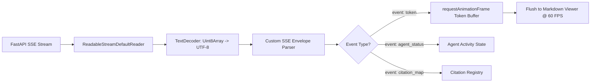

# Technical Explainer: Next.js 14 Reactive UI, SSE Stream Parsing & Interactive Citations

This document breaks down the frontend architecture, reactive stream processing algorithms, DOM AST transformations, and design rationale behind **Section 3.7 (Next.js Web Dashboard)** of DeepSearch-Local.

---

> [!NOTE]
> **Implementation Status: Phase 5 Placeholder**  
> While the Next.js 14 App Router, TypeScript environment, and Tailwind CSS scaffolding are initialized, the interactive UI components, live stream consumer, and citation popover drawers are scheduled for **Phase 5: FastAPI Streaming Backend & Next.js UI**. All unimplemented components in this document are explicitly marked with `[PLACEHOLDER - Phase 5]`.

---

## 1. The Core Frontend Challenge: Real-Time Streaming Without UI Thrashing

A deep research frontend faces unique reactive state challenges that do not occur in traditional web applications:

1. **High-Frequency Stream Thrashing:**
   During report drafting, a local 3B SLM streams 30–40 tokens per second. If every single token triggers a naive React state update (`setDocumentText(prev => prev + token)`), React executes 30–40 virtual DOM reconciliations per second. This causes browser thread lockup, dropped frames, and visible typing stutter.
2. **Multi-Channel State Demultiplexing:**
   The frontend must parse a single incoming byte stream into three completely independent reactive state stores:
   - The evolving Markdown document text (`token` stream)
   - The live agent status and graph drawer (`agent_status` stream)
   - The dynamic citation metadata registry (`citation_map` stream)
3. **Dynamic Citation Hydration:**
   Standard Markdown renders `[1]` as plain text. The frontend must parse the Markdown Abstract Syntax Tree (AST) in real time and transform citation markers into interactive floating popover triggers displaying source URLs, article titles, and quoted evidence snippets.

To solve this, DeepSearch-Local implements **chunked stream buffer batching** paired with **custom AST citation node transformation**.

---

## 2. Next.js 14+ App Router Architecture

The web dashboard is built on **Next.js 14+** using the modern App Router architecture:

```mermaid
flowchart TD
    subgraph Server_Boundary [Server Boundary: React Server Components (RSC)]
        Layout["app/layout.tsx\nRoot Shell, Fonts, Metadata, Global Styles"]
    end
    
    subgraph Client_Boundary [Client Boundary: 'use client' Interactive Tree]
        Page["app/page.tsx\nDashboard Controller & Research Coordinator"]
        
        ChatBar["components/ChatBar.tsx\n[PLACEHOLDER - Phase 5]\nResearch Brief Input & Breadth Config"]
        AgentDrawer["components/AgentDrawer.tsx\n[PLACEHOLDER - Phase 5]\nLive LangGraph State Visualization"]
        ReportViewer["components/ReportViewer.tsx\n[PLACEHOLDER - Phase 5]\nStreamed Markdown + KaTeX + Interactive Citations"]
        ExportToolbar["components/ExportToolbar.tsx\n[PLACEHOLDER - Phase 5]\nExport to Markdown / Print to PDF"]
    end
    
    Layout --> Page
    Page --> ChatBar & AgentDrawer & ReportViewer & ExportToolbar
```

### Server vs. Client Component Separation
- **Root Layout (`app/layout.tsx` - Server Component):** Loads typography (`GeistSans`, `GeistMono`), injects KaTeX stylesheets, and handles search engine metadata without shipping JavaScript to the client.
- **Interactive Leaf Nodes (`use client`):** Isolate client-side state hooks (`useState`, `useEffect`, `useRef`) strictly to components that consume streams or render interactive animations.

---

## 3. High-Throughput SSE Stream Processing: `ReadableStream` & Batching

### Why Not Standard `EventSource`?
The browser's native `EventSource` API has two significant limitations:
1. It only supports `GET` requests; sending structured research briefs with complex configuration parameters requires a `POST` request.
2. It does not provide fine-grained control over request headers or chunk buffers.

DeepSearch-Local uses the modern **Fetch API with `ReadableStream`** (`web/lib/sse-client.ts` [PLACEHOLDER - Phase 5]).



### Preventing React Re-Render Thrashing via `requestAnimationFrame`
To guarantee buttery-smooth 60 FPS rendering without stutter:
- Incoming tokens are pushed into an in-memory mutable string buffer (`tokenBufferRef.current += token`).
- A `requestAnimationFrame` (rAF) loop checks the buffer on each display refresh cycle (every 16.6 ms):
  - If new tokens have arrived, the buffer is flushed to the React state hook in a single batch.
  - If no tokens arrived, reconciliation is skipped.

This bounds React re-renders to at most 60 times per second, regardless of how fast the local SLM generates text.

---

## 4. Interactive Citations: Dynamic Markdown AST Transformation

A core UX innovation in DeepSearch-Local is **zero-latency interactive citations**. When a user hovers over or clicks a citation marker `[1]`, a popover appears displaying the exact evidence snippet extracted during RAG retrieval.

```
Report Text:
"AMD Ryzen 7950X package power peaks at 230W under full AVX-512 load [1]."
                                                                     ▲
                                                              Hover / Click
┌────────────────────────────────────────────────────────────────────────┐
│ AnandTech - "AMD Ryzen 7000 Power & Efficiency In-Depth"               │
│ https://anandtech.com/show/17585/amd-zen-4-ryzen-9-7950x-power         │
├────────────────────────────────────────────────────────────────────────┤
│ "Under Prime95 AVX-512 testing, total package power reached 230.4W     │
│  before hitting thermal throttling boundaries at 95°C."                │
└────────────────────────────────────────────────────────────────────────┘
```

### The AST Transformation Pipeline
`components/ReportViewer.tsx` leverages `react-markdown` with `remark-gfm` and `rehype-katex`:

```mermaid
flowchart TD
    RawMD[Streamed Markdown Text] --> Remark[Remark Parser: Generates Markdown AST]
    Remark --> CustomRule[Custom Plugin: Regex Match /\[(\d+)\]/]
    CustomRule --> ASTNode[Transform into Custom Citation Node]
    ASTNode --> Rehype[Rehype HTML Processor]
    Rehype --> ReactNode["CitationPopover Component\nReads metadata from citationMap[id]"]
```

### Component Architecture (`CitationPopover.tsx` [PLACEHOLDER - Phase 5])
```tsx
interface CitationPopoverProps {
  id: string; // e.g. "1"
  citationMap: Record<string, CitationMetadata>;
}

export function CitationPopover({ id, citationMap }: CitationPopoverProps) {
  const metadata = citationMap[`[${id}]`];

  return (
    <Popover>
      <PopoverTrigger asChild>
        <button className="inline-flex items-center px-1.5 py-0.5 mx-0.5 text-xs font-semibold rounded bg-cyan-950 text-cyan-400 hover:bg-cyan-900 border border-cyan-800 transition-colors">
          [{id}]
        </button>
      </PopoverTrigger>
      <PopoverContent className="w-80 p-3 bg-zinc-900 border border-zinc-800 text-zinc-100 shadow-xl rounded-lg">
        {metadata ? (
          <div className="space-y-1.5">
            <h4 className="text-xs font-bold text-cyan-400 line-clamp-1">{metadata.title}</h4>
            <a href={metadata.url} target="_blank" rel="noopener noreferrer" className="text-[10px] text-zinc-400 hover:underline flex items-center gap-1">
              {new URL(metadata.url).hostname} ↗
            </a>
            <blockquote className="text-xs italic text-zinc-300 border-l-2 border-cyan-600 pl-2 mt-1">
              "{metadata.snippet}"
            </blockquote>
          </div>
        ) : (
          <div className="text-xs text-zinc-500">Resolving source citation...</div>
        )}
      </PopoverContent>
    </Popover>
  );
}
```

---

## 5. Live Agent Activity Drawer

While commercial deep research systems hide agent reasoning behind a static spinner, DeepSearch-Local exposes the entire LangGraph state machine execution in the **Agent Activity Drawer** (`components/AgentDrawer.tsx` [PLACEHOLDER - Phase 5]).

```
┌──────────────────────────────────────────────────────────────────────┐
│ AGENT STATUS: [Active: Synthesis Loop (Iteration 1/2)]               │
├──────────────────────────────────────────────────────────────────────┤
│ ● 1. Planner Node: Multi-Section Outline Generated (5 sections)     │
│ ● 2. Search & Scrape: Executed 4 queries across DuckDuckGo           │
│   ├─ "AMD Ryzen 7000 AVX-512 power draw" [4 results]                 │
│   └─ "Zen 4 package power thermal throttle limits" [3 results]       │
│ ● 3. Dynamic Ingestion: 42 chunks indexed to Qdrant (CPU bge-small)  │
│ ◐ 4. Synthesis Loop: Drafting Section 2/5 ("Thermal Profiles")       │
│ ○ 5. Reflection Node: Pending gap audit                              │
│ ○ 6. Report Compiler: Pending final citation compile                 │
└──────────────────────────────────────────────────────────────────────┘
```

The drawer maintains an execution timeline, visualizes active network queries, lists visited URLs, and shows the reflection loop counter in real time.

---

## 6. Document Export Suite

Once `compiler_node` finishes and emits `event: done`, the user can export the completed research dossier:

1. **Export to Markdown (`.md`):**
   Downloads the exact text buffer including compiled sequential citation markers (`[1]`) and the complete unified bibliography.
2. **Print / Export to PDF:**
   Applies custom CSS `@media print` stylesheets:
   - Hides web chrome (chat bars, side drawers, export buttons).
   - Enforces clean page breaks (`page-break-inside: avoid` on tables, charts, and bibliography blocks).
   - Formats citations as standard academic footnotes.

---

## 7. Phase 5 Implementation Roadmap & Stubs Reference

The following web components and libraries are currently placeholders awaiting Phase 5 implementation:

| Module Path | Current Status | Planned Phase 5 Implementation |
| :--- | :--- | :--- |
| `web/app/page.tsx` | Scaffolded (welcome splash) | Full dashboard controller managing research session lifecycle and state. |
| `web/lib/sse-client.ts` | **[PLACEHOLDER - Phase 5]** | Multi-event SSE parser with `ReadableStream` reader and `rAF` batching. |
| `web/components/ChatBar.tsx` | **[PLACEHOLDER - Phase 5]** | Research brief input bar with breadth/depth slider configurations. |
| `web/components/AgentDrawer.tsx` | **[PLACEHOLDER - Phase 5]** | Real-time LangGraph state visualization and search log timeline. |
| `web/components/ReportViewer.tsx` | **[PLACEHOLDER - Phase 5]** | Streamed Markdown viewer with KaTeX math and AST citation popovers. |
| `web/components/CitationPopover.tsx` | **[PLACEHOLDER - Phase 5]** | Popover card displaying source URL, title, and quoted context snippet. |
| `web/components/ExportToolbar.tsx` | **[PLACEHOLDER - Phase 5]** | One-click Markdown file download and print-to-PDF formatting trigger. |

---

## 8. Summary Jargon Cheat Sheet

| Jargon Term | Plain English Definition | Role in DeepSearch-Local |
| :--- | :--- | :--- |
| **React Server Component (RSC)** | Component that executes only on the server, shipping zero JS to the browser. | Renders the root page shell, typography, and static metadata in `layout.tsx`. |
| **Client Component (`use client`)** | React component running on the browser capable of managing dynamic state. | Powers the interactive stream consumer, activity drawer, and popovers. |
| **ReadableStream** | Web Streams API interface representing a readable stream of byte data. | Reads chunked HTTP packets from FastAPI without waiting for request end. |
| **TextDecoder** | Native browser utility decoding raw `Uint8Array` binary streams into UTF-8 strings. | Converts raw SSE network chunks into parseable text. |
| **Re-render Thrashing** | Performance bottleneck where rapid state updates freeze the browser UI thread. | Prevented by buffering incoming SLM tokens with `requestAnimationFrame`. |
| **`requestAnimationFrame`** | Browser API telling the window to run an animation callback before the next repaint. | Synchronizes token stream flushes with the monitor's 60Hz/120Hz refresh rate. |
| **AST (Abstract Syntax Tree)** | Tree representation of the syntactic structure of source code or Markdown text. | Used to detect `[1]` citation patterns and replace them with React popover nodes. |
| **Interactive Popover** | Floating UI card that appears when hovering or clicking a document element. | Displays source URL, page title, and quoted snippet when clicking `[1]`. |
| **KaTeX** | Fast math typesetting library rendering LaTeX formulas directly in the browser. | Renders complex mathematical formulas inside streamed research reports. |
| **Hydration** | Process where client-side React attaches event listeners to server-rendered HTML. | Connects interactive citation hover events to the document text. |
